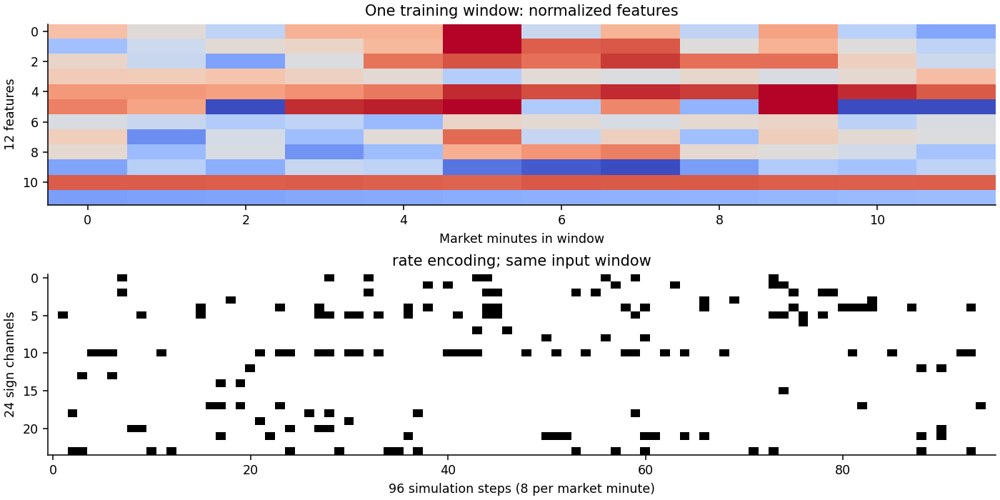
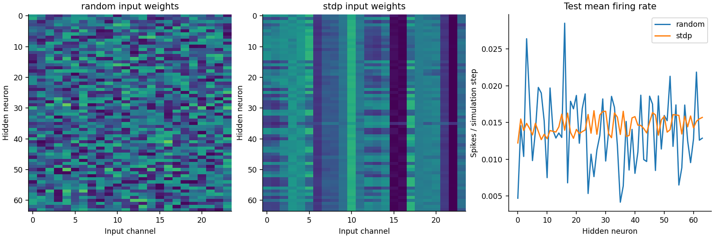
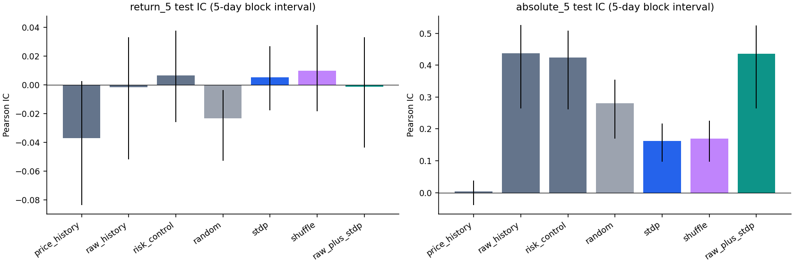
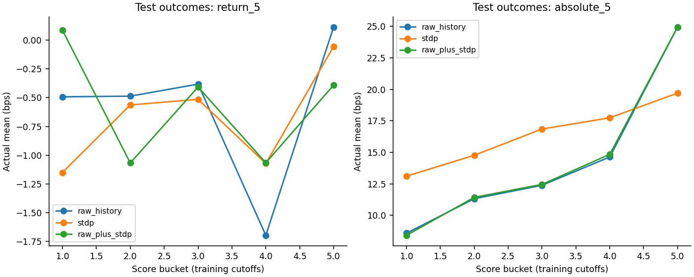
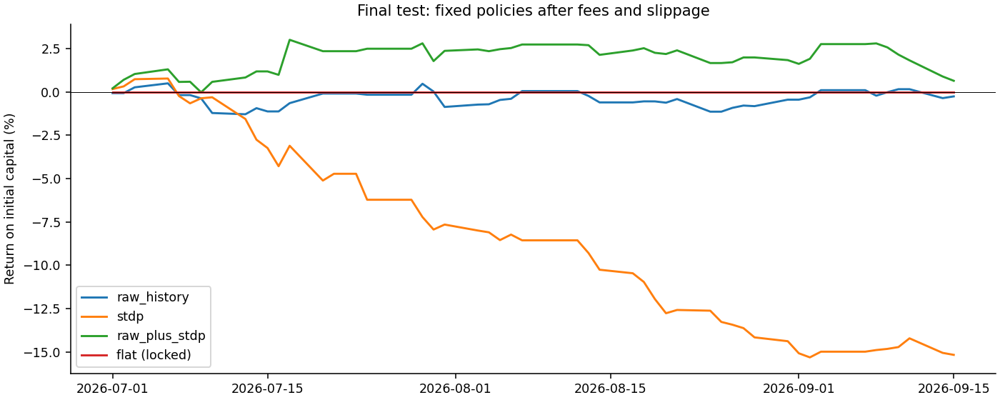

# 金融特征 → STDP-SNN → 连续预测 → IC分钟交易：独立研究报告

版本ic_independent_v1，完成日期2026-10-27。配置、代码、训练记录和完整数值均保存在本项目，旧research/、旧训练项目和原行情未被覆盖。本文报告实际执行结果，不把提出一种网络结构当作已经验证有效。

## 1. 研究结论

已完成18个SNN及其读出训练，并在未用于本轮选择的7—9月数据上完成预测分析和回测。主分析使用验证期选中的 **rate编码**。

- 5分钟收益预测：STDP集成IC **0.0055**，原始完整特征序列IC **-0.0017**，原始特征加STDP为 **-0.0013**。原始+STDP相对原始的IC差95%块重抽样区间为 **[-0.0139, 0.0171]**。
- 5分钟绝对收益（风险幅度）：STDP IC **0.1625**，仅已知波动水平与时钟的控制IC **0.4238**。风险相关不能直接解释为涨跌方向或可交易利润。
- 验证期锁定的策略是 **flat**；测试期交易 **0笔**，净盈亏 **0.00元**，100万元本金收益率 **0.000%**。固定STDP诊断策略净盈亏 **-151,741.86元**，下文同时给出毛收益和费用，不只展示最好结果。
- 测试期也有正收益对照：原始特征加STDP为 **6,446.12元（0.645%）**，删去支撑/阻力的原始特征为 **18,110.93元（1.811%）**。它们验证期亏损、没有成为正式策略；不能看完测试后改选赢家。

研究问题是：在时刻t可得到的金融信息中，SNN通过STDP得到的表示，是否包含未来收益或波动的增量信息，能否转化为扣除成本后的收益。输出不限定为单个spike；本次先得到192维神经元表示，再读出5个连续数值。**这是一项“无监督STDP表示 + 监督Ridge读出”的混合研究，不是纯无监督收益预测。**

## 2. 数据从哪里来、如何合并

使用老师提供的数据包经前序核验生成的data/standardized/ic_v1/contracts/。191个原始日期包跨2025-12-04至2026-09-15，提供7个有行情的具体IC合约：IC2606、IC2607、IC2608、IC2609、IC2610、IC2612、IC2703，共124800行。各日文件已按合约纵向合并为独立Parquet，原始数值保留；主连ICL8等六个滚动序列另存，**本次不将主连价格冒充真实合约成交价**。

|字段|含义/格式|
|---|---|
|contract_id / instrument_id|来自原文件名的具体合约代码，例如IC2606|
|datetime|带Asia/Shanghai时区的分钟时间，例2025-12-04 09:31:00+08:00|
|trading_date / session|日期字符串、AM/PM|
|open / high / low / close|float64，原始价格点数；没有自行复权、补值或四舍五入到tick|
|volume / open_interest|int64，当根成交量、持仓量；本次按手理解，但供应商单位尚未核实|
|source_id / source_row|来源成员哈希标识和原CSV行号，可追溯原始文件|
|quality_flags|底表质量标记|
|bar_id / segment_id / split|本研究新增的唯一行情行号、连续交易段、数据切分|
|12项特征列|仅由当时和此前行情计算的特征|

分钟没有成交额、买卖报价、委托队列或tick数据，因此不能重建原论文的逐笔VWAP，也不能验证一手在分钟开盘价一定能成交。供应商是否调整过价格、时间戳是开始还是结束、成交量单位仍未知。本文以结束时间戳为工作假设，回测属于条件历史模拟。

**每日选合约规则**：开盘前只看前一个原始包日期，要求某合约有240根分钟K线、总量≥1000、末根持仓≥1000；按持仓量最大选择，持仓量相同再按成交量和代码排序。距合约月份第三个周五3天起排除，属于保守研究截止规则，没有声称逐合约核实节假日顺延。当日所选合约缺数据就不交易，不能看完当日成交情况换一个合约补上。前包日没有行情也不使用陈旧信息代替。

IC2512及IC2601—2605等历史合约缺失，所以这是“已提供合约集合内的前日持仓选择”，不是完整市场的官方主力策略。训练恰好全部落在IC2606，跨合约泛化证据有限。

规则选中181日、43440行，产生27150个12分钟窗口。

|区间|首日|末日|合约日|窗口|行情行|合约|
|---|---|---|---|---|---|---|
|train|2025-12-05|2026-03-31|75|11250|18000|IC2606|
|validation|2026-04-01|2026-06-30|60|9000|14400|IC2606, IC2609|
|test|2026-07-01|2026-09-15|46|6900|11040|IC2609, IC2612|

缺失与保守跳过的完整记录如下。数据包日期并不等于经过交易所日历核验的全部交易日；年化统计沿用252日是假设。

|trading_date|information_date|contract_id|status|
|---|---|---|---|
|2025-12-04|—|—|no_previous_data|
|2026-07-22|2026-07-21|IC2609|selected_contract_missing_or_incomplete|
|2026-07-23|2026-07-22|—|no_previous_data|
|2026-07-27|2026-07-24|IC2609|selected_contract_missing_or_incomplete|
|2026-07-28|2026-07-27|—|no_previous_data|
|2026-08-10|2026-08-07|IC2609|selected_contract_missing_or_incomplete|
|2026-08-11|2026-08-10|—|no_previous_data|
|2026-08-12|2026-08-11|—|no_previous_data|
|2026-09-04|2026-09-03|IC2609|selected_contract_missing_or_incomplete|
|2026-09-07|2026-09-04|—|no_previous_data|

## 3. 训练、验证与最终测试

训练：2025-12-04至2026-03-31（首日因缺前日信息实际跳过）；验证：2026-04-01至06-30；最终测试：2026-07-01至09-15。旧实验已经观察过5—6月，所以本研究把它划入验证期，不再次称作全新测试集。模型只在训练期学习，验证期选Ridge惩罚、编码和交易阈值，最终测试期完全冻结。

每个合约、日期、半日和连续分钟分别处理。每半日120根K线，最早完整特征需20根此前统计且包含前一根收盘，随后12分钟组成窗口；信号时间约10:03—11:17和13:33—14:47，每日150个样本。为统一1/3/5/10分钟目标及延迟敏感性，所有模型使用共同可用窗口，牺牲开盘和尾盘一部分样本。没有填补断档，没有跨合约拼特征或把午休当一分钟。

**标签时间关系**：假设t为信号K线结束时间。使用第t+2根K线open作为入场参考，解释为至少留出一整分钟；第t+2+h根open为退出参考，h∈{1,3,5,10}。标签为`10000 × (O[t+2+h]/O[t+2] − 1)`，单位bps（1bp=0.01%）。主要目标为h=5；辅助目标为其绝对值。这些标签仅用于监督读出、验证和事后评价，从不进入STDP更新。

例如10:03收盘产生信号，使用标记10:05的K线open（按结束时间解释是10:04）入场，标记10:10的open（10:09）退出，实际持有5分钟。不能把“预测5分钟收益”说成“已证明提前5分钟预警事件”；本研究验证的是延迟后的未来持有区间，没有测出事件首次发生的预警时间分布。

## 4. 用了什么特征、怎样计算

设C/H/L/V/OI为当根收盘/最高/最低/量/持仓；`TR[t]=max(H−L, |H−C[t−1]|, |L−C[t−1]|)`，`A[t]=mean(TR[t−20:t−1])`。设`r[t]=ln(C[t]/C[t−1])`，`σ20[t]=std(r[t−20:t−1], ddof=0)`，`σ5[t]=std(r[t−4:t], ddof=0)`。所有“此前20根”明确排除当前K线。当前收盘、最高、最低、量和持仓均在t收盘后才可使用。

|编号/代码|公式|提出它的经济假说|
|---|---|---|
|1 return_1_atr|`(C[t]−C[t−1])/A[t]`|短期买卖压力，相对近期波动尺度|
|2 return_3_atr|`(C[t]−C[t−3])/A[t]`|数分钟趋势或反转条件|
|3 efficiency_5|`(C[t]−C[t−5])/Σ(i=t−4..t)abs(C[i]−C[i−1])`|相同净变化是单向推进还是来回震荡|
|4 resistance_distance|`(max(H[t−20:t−1])−C[t])/A[t]`|距离已知阻力的程度；负值表示已突破此前高点|
|5 support_distance|`(C[t]−min(L[t−20:t−1]))/A[t]`|距离已知支撑的程度；负值表示跌破此前低点|
|6 close_location|`(2C−H−L)/(H−L)`|收盘靠近当根上沿/下沿的压力|
|7 volatility_ratio|`ln((σ5+1e−8)/(σ20+1e−8))`|近期波动相对背景是否扩张|
|8 range_ratio|`ln(max(H−L,1e−6)/A[t])`|本分钟振幅是否异常|
|9 volume_surprise|`ln(1+V[t])−ln(1+mean(V[t−20:t−1]))`|成交活动相对近期是否放大|
|10 oi_change|`ln(1+OI[t])−ln(1+OI[t−1])`|仓位增减，与价格路径组合可能区分增仓/减仓驱动|
|11 volatility_level|`ln(1+10000σ20[t])`|已知波动水平，控制普通波动持续性|
|12 session_progress|`2×(当前分钟−半日首分钟)/119−1`|可预知时钟位置，控制日内季节性|

ATR和振幅除法分母下限1e−6，路径效率分母下限1e−8；无足够历史的行保留缺失并排除，不回填。支撑/阻力是历史价位，不是天然“无滞后、一定预测未来”的指标；其有效性必须看样本外与删去价位特征的对照。没有用未来K线确认的峰谷回填过去。

归一化在训练期14850个唯一有效分钟拟合，避免重叠窗口重复加权：每列`s_j=quantile_0.99(|f_j|)`，下限1e−8；`z_j=clip(f_j/s_j,−1,1)`。保留金融零点，不按全样本归一化。验证/测试超训练范围截断，不更新尺度。实际尺度见data_summary.json。各输入本身及读出再次标准化的均值/方差都只用训练数据。

以下为每个特征末值与未来目标的测试期单变量相关，属于解释性诊断，未据此删选特征或重训；相关不等于因果或独立增量。

|feature|return_5_ic|absolute_5_ic|clip_fraction|
|---|---|---|---|
|return_1_atr|-0.0145|-0.0027|0.0035|
|return_3_atr|-0.0099|0.0009|0.0039|
|efficiency_5|0.0228|0.0068|0.0600|
|resistance_distance|-0.0376|0.0179|0.0119|
|support_distance|0.0355|0.0151|0.0065|
|close_location|-0.0110|-0.0037|0.1417|
|volatility_ratio|-0.0106|0.0265|0.0084|
|range_ratio|0.0028|0.0238|0.0016|
|volume_surprise|-0.0118|-0.0063|0.0001|
|oi_change|0.0143|-0.0059|0.0122|
|volatility_level|-0.0182|0.4277|0.0230|
|session_progress|-0.0044|-0.0982|0.0000|

## 5. 如何encoding

每个有符号特征拆成`z+=max(z,0)`与`z−=max(−z,0)`，12项变24输入通道，顺序为全部正通道后全部负通道。每分钟8个仿真步，12分钟共96步；仿真步没有真实逐笔微观时序含义，不能解释为市场125毫秒信息。

两种预先固定编码：

1. **rate**：逐步概率`p=0.30×z±`，当均匀随机数u<p时发一个脉冲，属于离散Bernoulli的Poisson式速率近似，不是精确连续时间Poisson过程。随机数由样本ID、步/通道和种子确定，批大小变化不改变同一样本编码；同一训练窗口各轮使用固定编码。
2. **density**：同样p，但用累计概率跨步累加，累计值跨越整数就发放；24通道用固定不同相位减少同步。窗口内保持相位，样本边界重置。累计脉冲数与累计概率相差小于1，不额外制造随机噪声。

例如z=+0.5，正通道每步p=0.15，负通道0，一个市场分钟8步期望1.2个正脉冲；z=−0.5则交换通道。并非每个通道每分钟一定发放。部分天然非负特征会有不活跃的负通道，保留统一通道接口。



## 6. SNN结构、STDP和输出

```text
12分钟 × 12金融特征
  → 正负拆分24通道 → 96仿真步脉冲
  → 24×64非负输入突触（STDP学习）
  → 单个隐藏层：64竞争LIF神经元
  → 全窗发放率64 + 末3分钟发放率64 + 末膜电位64 = 192维
  → 监督Ridge读出 → 1/3/5/10分钟收益及5分钟绝对收益，共5个数
```

有**1个隐藏层，64个隐藏神经元，24个输入通道，1536个可塑输入权重**；不设置原论文的单个输出LIF。神经元响应没有天然“买入”“卖出”标签。192维表示是供后续金融读出使用的信息集合。

下面是最终测试前三个样本的实际连续输出（所选编码、3种子平均），价格变化均以bps计；它们不是概率，也不是指数点。最后一列仅供事后评价，不是模型输入。

|样本|合约|信号时间|预测1m|预测3m|预测5m|预测10m|预测绝对5m|事后真实5m|
|---|---|---|---|---|---|---|---|---|
|20250|IC2609|2026-07-01 10:03:00+08:00|0.1402|0.6217|0.4106|0.6214|15.1565|-16.0912|
|20251|IC2609|2026-07-01 10:04:00+08:00|0.3916|0.2747|0.1843|0.1492|14.3351|-22.4437|
|20252|IC2609|2026-07-01 10:05:00+08:00|0.1719|0.4315|0.4677|-0.1370|14.5751|-4.7639|

LIF在仿真步s执行：`u=exp(−1/16)×v + W×x`。阈值为`1+θ_j`，超过阈值的神经元中选择`u−threshold`最大者发放，每样本每步最多1个赢家；赢家膜电位清零，其他神经元扣除0.15抑制量，下限0。没有额外不应期和跨样本记忆。训练期`θ←0.999θ+0.03×batch_mean(post)`使常发放神经元阈值更高；验证/测试完全冻结θ。

迹式成对STDP，前/后迹先乘`exp(−1/16)`，再计算当前更新，最后把本步脉冲加进迹。对权重W[j,i]：

`ΔW = 0.012(1−W)×mean(post_now[j]×pre_trace[i]) − 0.014W×mean(post_trace[j]×pre_now[i])`。

此前输入脉冲与当前输出配对使权重增大；此前输出与当前输入配对使权重减小，**同一仿真步零时间差不配对**。每步截断权重至[1e−6,1]，按每个隐藏神经元输入权重和4.8归一，再限制上界1。权重非负不等于预测只能做多：金融正负信息由不同输入通道表达，读出系数可正可负。

每样本开始膜电位和迹清零，权重/训练阈值跨批保留；训练窗口随机排序但窗口内部市场顺序保留。批128，3轮，种子104/211/307；每种编码分别运行随机权重、STDP和打乱顺序STDP，共18个神经模型。打乱版先编码再打乱前11分钟块，末分钟不动，保留同窗口输入脉冲集合；网络和读出均重新训练。特征本身含滚动历史，所以该对照不能证明完全剥离了全部时序信息。

随机权重对照也用训练数据校准阈值，以避免把阈值适配误算成STDP贡献。保存后复载与冻结检查通过，训练/测试期间活动、权重差异和表示有效秩见下表。

|编码|模式|训练活跃数|测试活跃数|权重L2变化均值|权重余弦均值|测试有效秩均值|
|---|---|---|---|---|---|---|
|rate|random|64–64|64–64|0.0000|0.7676|13.8235|
|rate|stdp|64–64|64–64|5.8895|0.9549|13.4220|
|rate|shuffle|64–64|64–64|5.5806|0.9482|14.0353|
|density|random|64–64|64–64|0.0000|0.7676|19.1595|
|density|stdp|64–64|64–64|5.6090|0.9492|21.9646|
|density|shuffle|64–64|64–64|5.4103|0.9391|22.1661|

有效秩按表示中心化奇异值能量的熵计算；活跃神经元多不代表表示不冗余，更不代表收益可预测。权重相似度高说明不同神经元可能学到相近组合。



## 7. 读出、基线、选择与预测分析

Ridge以训练期标准化表示拟合目标，最小化平方误差加`α||β||²`。α候选0.1/1/10/100/1000/10000，各目标独立按验证MSE选择；风险预测负数截为0。验证后没有使用验证标签重训，因此最终训练日期仍止于3月31日。三个种子预测等权平均，编码按验证5分钟收益MSE确定。

|对照|输入读出维数|用于回答的问题|
|---|---:|---|
|mean|常数|只预测训练均值能怎样|
|price_history|12×4=48|仅1/3分钟变化、效率、当根位置是否已足够|
|raw_last|12|是否需要整个输入窗口|
|raw_history|12×12=144|特征本身的线性预测能力|
|without_levels|12×10=120|删除支撑/阻力距离是否变化|
|risk_control|2|波动水平和时段进度能解释多少风险信息|
|random / stdp / shuffle|192|随机非线性映射、STDP学习及时序顺序贡献|
|raw_plus_stdp|144+192=336|STDP是否在原始特征之外增加信息|

选择锁写入UTC 2026-10-27T12:07:26.370348+00:00，其文件哈希为 `2cd2c1aacdcbe4d95b501c71eecaf639cf86cc354dfeabe60f3da0b317dde647`。验证期最终选择编码 **rate**、策略 **flat**。最终测试之前尚未产生本轮测试预测；锁中保存模型/读出及核心源文件哈希，评价入口逐个核验。

|model|quantile|threshold|trades|net_pnl|
|---|---|---|---|---|
|price_history|0.950|0.875|249|-119,298.638|
|raw_last|0.900|0.678|309|-75,040.261|
|raw_history|0.950|2.821|104|-24,065.345|
|without_levels|0.950|2.667|84|-8,425.653|
|random|0.950|2.211|203|-146,363.206|
|stdp|0.950|1.647|213|-73,548.411|
|shuffle|0.900|1.502|412|-114,823.912|
|raw_plus_stdp|0.950|2.994|142|-65,592.308|

Pearson IC是预测与未来收益的相关系数，Rank IC衡量排序关系；RMSE单位bps。方向准确率包含零收益样本，不使用50%作为无条件显著性判断。分钟窗口和目标互相重叠，不能把6900条当独立观测：以包日期为序，用连续5日块、1000次重抽样构造95%区间；模型差异使用相同重抽样块。它反映本样本不确定性，不是对众多模型/指标做过多重检验校正的确认性结论。

**主要5分钟收益目标**

|模型|验证IC|测试IC|95%区间|Rank IC|RMSE(bps)|方向准确率|日均IC|
|---|---|---|---|---|---|---|---|
|mean|—|—|[nan, nan]|—|23.2504|0.4683|—|
|price_history|-0.0004|-0.0371|[-0.0836, 0.0029]|-0.0298|23.2710|0.4790|0.0051|
|raw_last|0.0018|-0.0288|[-0.0641, 0.0003]|-0.0265|23.2663|0.4843|0.0116|
|raw_history|0.0237|-0.0017|[-0.0518, 0.0332]|-0.0077|23.2871|0.4854|-0.0053|
|without_levels|0.0190|-0.0003|[-0.0477, 0.0393]|-0.0054|23.2818|0.4875|0.0080|
|risk_control|-0.0132|0.0066|[-0.0259, 0.0379]|0.0107|23.2496|0.4945|0.0108|
|random|0.0140|-0.0233|[-0.0527, -0.0034]|-0.0255|23.3041|0.4864|-0.0179|
|stdp|0.0195|0.0055|[-0.0175, 0.0269]|0.0021|23.2637|0.4913|0.0145|
|shuffle|-0.0019|0.0098|[-0.0183, 0.0419]|0.0150|23.2641|0.4978|0.0278|
|raw_plus_stdp|0.0250|-0.0013|[-0.0435, 0.0334]|-0.0018|23.2936|0.4928|-0.0030|

**5分钟风险幅度目标**

|模型|绝对收益IC|95%区间|Rank IC|RMSE(bps)|
|---|---|---|---|---|
|mean|—|[-0.0000, 0.0000]|—|16.6366|
|price_history|0.0045|[-0.0389, 0.0374]|0.0034|16.6366|
|raw_last|0.4261|[0.2631, 0.5142]|0.3226|15.4742|
|raw_history|0.4373|[0.2640, 0.5270]|0.3261|14.8872|
|without_levels|0.4374|[0.2670, 0.5242]|0.3262|14.8892|
|risk_control|0.4238|[0.2610, 0.5093]|0.3205|15.5031|
|random|0.2809|[0.1698, 0.3554]|0.2318|15.8953|
|stdp|0.1625|[0.0964, 0.2168]|0.1308|16.4202|
|shuffle|0.1689|[0.0972, 0.2252]|0.1298|16.3969|
|raw_plus_stdp|0.4358|[0.2645, 0.5251]|0.3257|14.8908|

**不同持有时域的测试收益IC**（不是事件预警提前量）

|model|return_1|return_10|return_3|return_5|
|---|---|---|---|---|
|random|-0.0089|-0.0048|-0.0228|-0.0233|
|raw_history|-0.0338|0.0082|-0.0126|-0.0017|
|raw_plus_stdp|-0.0327|0.0124|-0.0100|-0.0013|
|stdp|-0.0097|0.0363|0.0020|0.0055|

**收益IC成对差异的块重抽样**

|比较|ic|ci_low|ci_high|
|---|---|---|---|
|stdp_minus_raw_history|0.0072|-0.0246|0.0546|
|raw_plus_stdp_minus_raw_history|0.0004|-0.0139|0.0171|
|random_minus_raw_history|-0.0216|-0.0487|0.0152|
|shuffle_minus_raw_history|0.0115|-0.0153|0.0576|
|stdp_minus_random|0.0288|0.0100|0.0516|
|stdp_minus_shuffle|-0.0043|-0.0344|0.0179|
|raw_history_minus_without_levels|-0.0014|-0.0196|0.0140|

**风险幅度IC成对差异**

|比较|ic|ci_low|ci_high|
|---|---|---|---|
|stdp_minus_raw_history|-0.2748|-0.3203|-0.1527|
|raw_plus_stdp_minus_raw_history|-0.0015|-0.0034|0.0007|
|random_minus_raw_history|-0.1565|-0.1830|-0.0824|
|shuffle_minus_raw_history|-0.2684|-0.3151|-0.1491|
|stdp_minus_random|-0.1183|-0.1485|-0.0667|
|stdp_minus_shuffle|-0.0064|-0.0155|0.0046|
|raw_history_minus_without_levels|-0.0000|-0.0052|0.0034|



**月份稳定性（收益IC）**

|value|random|raw_history|raw_plus_stdp|shuffle|stdp|
|---|---|---|---|---|---|
|2026-07|-0.0418|-0.0087|-0.0148|-0.0139|-0.0049|
|2026-08|0.0052|-0.0047|-0.0014|0.0497|0.0119|
|2026-09|-0.0219|-0.0252|-0.0007|0.0396|0.0427|

**所选编码三个STDP种子（收益目标）**

|model|ic|rank_ic|rmse|
|---|---|---|---|
|rate_stdp_s104|0.0148|0.0058|23.2668|
|rate_stdp_s211|-0.0072|0.0008|23.2821|
|rate_stdp_s307|0.0037|0.0028|23.2793|

逐日和逐合约结果保存在stability.csv。IC2612只有2026-09-15一天，不能据此证明跨合约稳定性。

连续预测的五组阈值只由训练预测20/40/60/80%分位决定，再放到测试集统计；没有根据测试分位重新定义高分组。分组结果用于解释，不据此改变已锁定交易阈值。所有编码、种子、时域和月份指标完整保留，主表只汇总预先定义的对照。



## 8. 回测怎样执行、成本如何计算

选择策略和阈值只用验证期：每个候选模型的绝对预测门槛来自训练预测的0/50/75/90/95%分位，要求验证至少30笔交易，取验证净收益最高的门槛。总体只在raw_history、stdp、raw_plus_stdp和不交易之间选择，其他模型用于诊断。验证成绩承担选择职能，不能当成独立的效果证据。

每个符合门槛且当根量≥20的信号，预测正值做多、负值做空；最多一手、一个未成交订单或持仓，不叠仓；入场延迟与标签一致，持有5分钟，不跨午休、隔夜。即使预测“风险高”也不会擅自将其当成做多方向，本次风险读出仅评价信息。已经持仓期间忽略新信号；退出后才允许后续信号入场。

按顺序模拟每根bar开盘的退出/入场，再在收盘盯市和产生新信号。入场bar成交量为0则视为无法成交；退出bar量0则等后续可成交bar，若无法在同段退出则显式报错。分钟成交量只作为事后执行可行性代理，不能保证开盘报价实际存在。没有订单簿、涨跌停撮合、盘口价差或市场冲击模型，滑点情景只提供近似。

|参数|基础情景|
|---|---|
|IC乘数/最小价位|200元/点，0.2点，故1tick=40元/手|
|初始资金/手数|1,000,000元，每次1手，余额需覆盖20%名义保证金另加1000元缓冲|
|开仓手续费|名义金额×(0.23+0.10)bps + 1元申报费假设|
|日内平仓手续费|名义金额×(2.30+0.10)bps + 1元申报费假设|
|滑点|买入价加0.2点，卖出价减0.2点，来回80元|
|资金利息/融资/其他税费|未计；没有虚构资金收益|

一笔交易的未滑点毛盈亏=`方向×(退出open−入场open)×200`；净盈亏=毛盈亏−双边滑点−按实际滑后名义价格计算的双边手续费。资金收益率以100万元为分母，不用保证金作为分母放大收益。分钟收盘盯市含未平仓损益用于回撤；所有包日期（包括缺行情空仓日）进入每日收益与Sharpe。只按分钟收盘盯市会漏掉分钟内更大不利波动，因此回撤不是逐笔精确极值。

例如7000点附近的一手来回基础费用约384元，再加80元滑点，约464元，即2.32点或3.31bps。平今费用显著高于开仓费；几分钟的小幅预测优势不一定覆盖这一门槛。实际账户费率没有提供，20%保证金和经纪附加费均是研究假设。费率引用及其适用边界见文末资料。

**最终测试：基础成本情景**。除验证锁定策略外，其余是事先列出的诊断交易，不能事后选最好者替代正式结果。Sharpe按短样本日收益年化，只作描述。

|model|trades|gross_pnl|fees|slippage|net_pnl|return_pct|max_drawdown_pct|daily_sharpe|
|---|---|---|---|---|---|---|---|---|
|price_history|224|-4,921.387|96,035.735|17,920.000|-118,877.122|-11.888|-12.845|-4.121|
|raw_last|254|-55,799.707|109,360.371|20,320.000|-185,480.078|-18.548|-19.810|-5.245|
|raw_history|64|30,239.062|27,674.137|5,120.000|-2,555.074|-0.256|-3.050|-0.208|
|without_levels|58|47,719.531|24,968.596|4,640.000|18,110.935|1.811|-3.156|1.267|
|random|161|-18,841.113|69,019.462|12,880.000|-100,740.575|-10.074|-11.899|-3.661|
|stdp|181|-59,560.938|77,700.918|14,480.000|-151,741.855|-15.174|-16.466|-7.810|
|shuffle|335|54,799.414|143,594.987|26,800.000|-115,595.573|-11.560|-14.953|-2.996|
|raw_plus_stdp|94|54,559.961|40,593.844|7,520.000|6,446.117|0.645|-2.879|0.446|
|flat|0|0.000|0.000|0.000|0.000|0.000|0.000|0.000|

**固定门槛的敏感性**

|model|scenario|trades|net_pnl|return_pct|
|---|---|---|---|---|
|raw_history|base|64|-2,555.074|-0.256|
|raw_history|zero_slippage|64|2,564.710|0.256|
|raw_history|two_ticks|64|-7,674.859|-0.767|
|raw_history|high_fees|64|-14,459.316|-1.446|
|raw_history|extra_minute|64|-593.993|-0.059|
|without_levels|base|58|18,110.935|1.811|
|without_levels|zero_slippage|58|22,750.653|2.275|
|without_levels|two_ticks|58|13,471.216|1.347|
|without_levels|high_fees|58|7,370.907|0.737|
|without_levels|extra_minute|58|1,949.835|0.195|
|stdp|base|181|-151,741.855|-15.174|
|stdp|zero_slippage|181|-137,262.642|-13.726|
|stdp|two_ticks|181|-166,221.069|-16.622|
|stdp|high_fees|181|-185,174.845|-18.517|
|stdp|extra_minute|178|-162,311.011|-16.231|
|raw_plus_stdp|base|94|6,446.117|0.645|
|raw_plus_stdp|zero_slippage|94|13,965.836|1.397|
|raw_plus_stdp|two_ticks|94|-1,073.601|-0.107|
|raw_plus_stdp|high_fees|94|-11,017.152|-1.102|
|raw_plus_stdp|extra_minute|92|-18,372.592|-1.837|

**事后补充的盈亏不确定性诊断**：按连续5日块重抽样55个包日期的人民币日盈亏，1000次95%区间；未用于选策略，不是下一期盈利保证。

|模型|实际总盈亏|55日块重抽样下限|55日块重抽样上限|
|---|---|---|---|
|raw_history|-2,555.07|-42,243.98|40,233.05|
|without_levels|18,110.93|-48,044.59|106,311.12|
|stdp|-151,741.86|-232,670.71|-89,038.59|
|raw_plus_stdp|6,446.12|-46,843.38|63,241.87|



成本敏感性固定同一信号门槛，包括0/2tick单边滑点、更高账户费率（开0.92bps、平今2.99bps，不另加基础经纪加价）和多等待1分钟成交。没有利用测试成本情景重新选择模型；高费率是参考公司公示的研究情景，不是用户账户报价。

## 9. 结果能说明什么、还不能说明什么

原始特征加STDP相对原始特征的收益IC差异区间跨零，本轮没有确认STDP带来稳定的增量方向信息。

单独STDP收益IC区间也跨零，不能把点估计或某个种子成绩当作可靠方向预测。

需要保留一个有限的正面发现：STDP比随机SNN的收益IC高0.0288，成对区间[0.0100, 0.0516]高于零。它改善了这个较差的随机对照，但STDP自身方向IC未稳定高于零，也没有在原始特征之上确认增量，不能据此得出可盈利结论。

STDP风险幅度IC区间[0.0964, 0.2168]高于零，说明有未来波动幅度的相关信息。但波动水平/时间控制IC为0.4238，原始完整特征为0.4373，需要与这些普通信息比较，不能将全部风险可预测性归功于STDP。

验证阶段已选择不交易，因此正式冻结策略测试收益为0。这不是SNN赚取收益；它说明已有候选在验证成本后不足以支持上线交易。其他固定模型的测试回测仍完整给出，没有为了展示收益而跳过亏损。

固定STDP策略扣费后不盈利，所以即使某些预测统计量为正，本次仍不能将其解释为可用的日内赚钱策略。

具体分解：STDP毛盈亏-59,560.94元，加上手续费77,700.92元和滑点14,480.00元后得到上述净亏损。这不只是费用把一个赚钱信号吃掉：其固定阈值下的毛交易结果也为负。原始完整特征毛盈亏30,239.06元，扣费后-2,555.07元，则体现出成本覆盖不足。

原始特征加STDP的测试净盈利6,446.12元需要如实保留，但单边2tick时变为-1,073.60元，多延迟1分钟时变为-18,372.59元，说明这段小幅正收益不稳健。删除支撑/阻力的原始特征对照盈利18,110.93元，延迟1分钟后降到1,949.83元；这是无需SNN的诊断对照，且验证期亏损，不能改称已验证盈利策略。

神经层面，STDP三个种子的平均突触余弦相似度约0.955，不同隐藏神经元的输入偏好较接近。风险IC也低于随机SNN的0.2809。这提示当前竞争/权重归一化和压缩可能没有保留最有用的金融信息，是后续在新验证方案内检查的方向；本实验没有证明它就是失败的因果机制。

删除支撑/阻力后的收益IC为-0.0003，完整原始特征为-0.0017；这是本次设定下的对照，不足以概括所有支撑阻力定义。真实顺序STDP与打乱历史版本IC分别0.0055和0.0098，应结合随机对照、月份和区间判断，不能仅凭微小点差宣称学到了金融因果时序。

这次已经把流程实际跑完：整理明确合约→因果特征→编码→STDP训练→连续读出→冻结样本外预测→条件回测。它没有穷尽所有SNN结构或策略；一个方案未有效，不能推断所有SNN无用；一个辅助风险指标相关，也不能推断有可交易方向优势。

主要限制：只有一次时间留出、46个实际测试合约日且最后IC2612只有一天；2025末—2026一段行情，训练与测试合约和市场状态变化；早期合约集合缺失；来源口径未完整核实；缺少盘口和实盘执行数据；STDP时间常数16仿真步仅约两市场分钟，12分钟窗口的长时依赖仍可能不足；硬竞争、正权重及固定参数只是一个可复现起点；读出线性且样本窗口重叠；表征的192维不代表192个独立有效因子。

下一轮建议先补全IC历史月份和数据说明，再在训练/验证内进行滚动训练、多日尺度支撑阻力与更强基线研究；如继续研究风险读出，应评估减仓/择时或风险过滤价值，而非直接当做多头策略。任何根据本报告结果改方案的实验，7—9月就成为已观察样本，需更晚或其他独立数据做新确认，不应反复优化后仍称其为首次样本外检验。

## 10. 产物、验证和复现

新增9项机制/因果/执行测试通过；原数据层及旧项目29项测试另行回归，合计38项。训练阶段运行约533.4秒（CPU、2个PyTorch线程；不作为性能基准）。实际产物复核如下（不靠重新选择模型修饰结果）：

|检查|通过|
|---|---|
|source_inputs_unchanged|True|
|models_unchanged|True|
|core_sources_unchanged|True|
|selection_lock_unchanged|True|
|finite_inputs_and_labels|True|
|all_saved_predictions_finite|True|
|sample_id_unique|True|
|all_base_trades_reconciled|True|
|all_18_neural_checkpoint_reloads_exact|True|

主要产物均在本报告目录：

- data_summary.json、contract_selection.csv、bars_features.parquet、samples.parquet、dataset.npz：来源哈希、选择、特征、样本元数据、归一化窗口和标签。
- models/：18个SNN检查点和全部Ridge读出；representations/：各模型训练/验证/测试隐藏表示。
- training.log、training_diagnostics.json、test_neural_diagnostics.json：实际训练与状态检查。
- train_predictions.parquet、validation_predictions.parquet、test_predictions.parquet：逐样本、逐目标、逐模型预测，含sample_id/contract_id/time。
- validation_metrics.csv、validation_policy_grid.csv、selection_lock.json：验证证据与选择锁。
- test_metrics.csv、bootstrap.json、additional_comparisons.json、stability.csv、score_buckets.csv、feature_analysis.csv：完整预测分析。
- backtest_summary.csv、backtests/*_trades.csv、*_daily.csv、*_equity.parquet：交易/成本/权益复核。
- evaluation_complete.json、verification.json、test_results.json、pnl_uncertainty.csv、artifact_manifest.json、figures/：完成证据、测试记录、复查、事后盈亏区间、产物哈希和图表。哈希清单排除清单自身与仍可能被重定向写入的report_build.log。

从项目根目录使用现有.venv。完整重跑时复制配置并更换output_dir，旧选择锁和结果不覆盖；重跑旧测试只是复现，不会使样本重新变成未见。代码入口及命令见../../README.md。标准底表路径保持不变，Python/依赖版本记录于锁和requirements.txt；独立实现没有import用户旧research或snn_quant。

资料依据：本地Gao、Luk、Weston（2021）论文（PDF第9—12页相关结构、滚动检验与交易定义）；SpikingJelly stdp_linear_step、BindsNET PostPre与早期竞争SNN作为机制参考；本项目不是原文精确复现。原文已经包含前瞻窗口、按日滚动样本外和随机择时对照，本研究的主要扩展是多维特征表示、增量检验及明确交易成本，而非声称首次进行前瞻分析。

- [中金所IC合约细则](https://www.e-cffex.com.cn/u/cms/www/202001/17094604ed9c.pdf)：乘数、tick与期限规则。
- [中金所2023年第16号通知](https://www.cffex.com.cn/jystz/20230317/31868.html)及[期货公司转载](https://www.ccbfutures.com/main/a/20230317/60122.shtml)：2023-03-20起平今费率万分之2.3；[财联社报道](https://www.cls.cn/detail/1298553)交叉核对。
- [东海期货历史收费公告](https://qh168.com.cn/article?article_id=304&cat_code=GongGao)：开仓万分之0.23与1元申报收费依据。未完成全样本历史费率变更审计，故仅为成本假设依据。
- [中银期货收费公示](https://www.bocifco.com/newsinfo.aspx?cid=7&id=49925)：公司费用不同于交易所基础费用，高费率情景参考。

资料核对日期2026-10-27；具体仓库版本和方法差异详见../../SOURCES.md。
