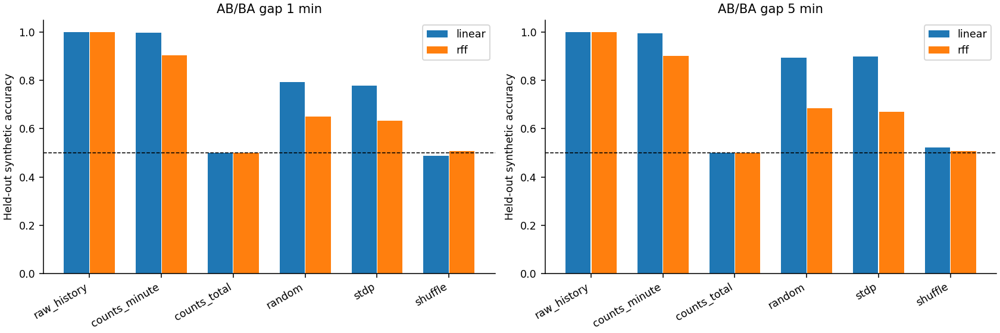
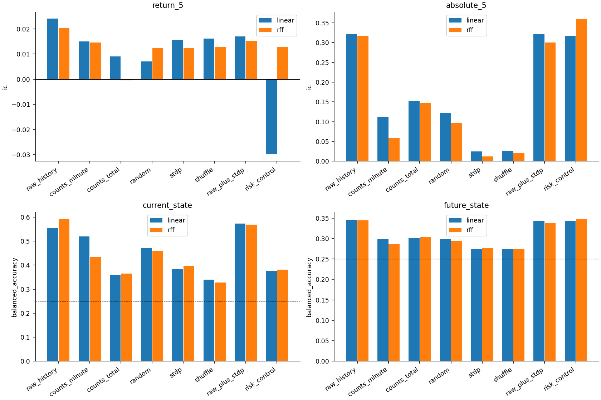
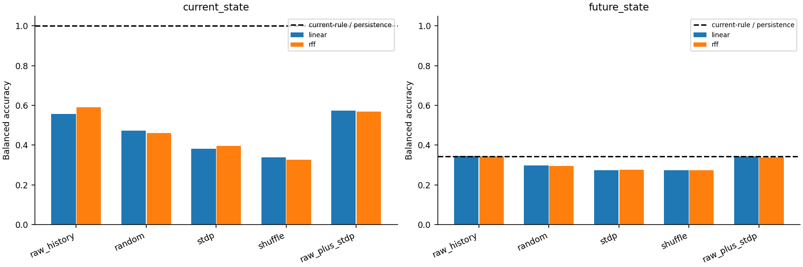
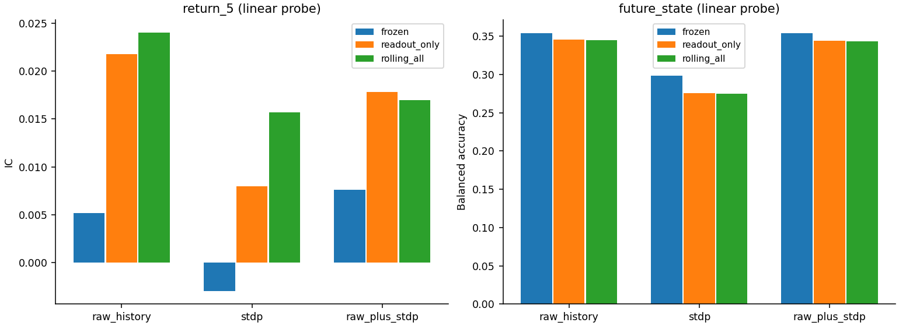
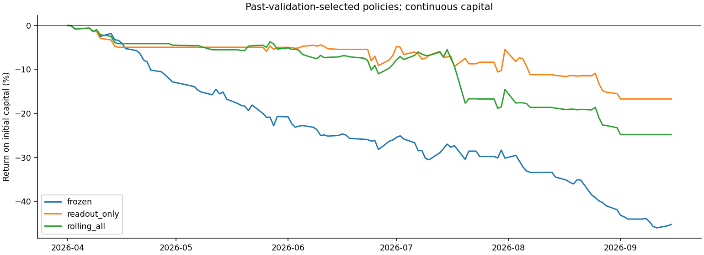

# 滚动训练、时序能力与市场状态：SNN/STDP定位实验报告

2026-10-28，版本rolling_diagnostics_v2。用户提出STDP可能更适合识别市场状态，并同意滚动训练和四组定位实验。本报告给出实际执行结果，v1完整保留。**4—9月在前期已经观察过，因此本轮属于滚动历史检验与探索性诊断，不是新取得的独立测试。**

## 1. 这次回答了什么

- 合成序列：原始完整序列接近100%，全窗计数严格50%；STDP能保留部分先后信息，随机SNN也能做到，不能把全部顺序能力归功于STDP。
- 滚动训练：STDP线性读出的收益IC从冻结组-0.0030变为全滚动0.0157，全滚动自身95%区间[-0.0032, 0.0425]；后文用配对区间判断改善是否明确，而不按点估计选赢家。
- 市场状态：全滚动STDP未来状态balanced accuracy为0.2745，原始特征为0.3449，状态持续基线为0.3431。当前状态识别和未来预测分开报告。
- 交易：逐段用过去验证选择的全滚动策略，115包日期连续资金模拟净盈亏-247,990.91元；冻结策略为-452,401.47元。它们都属于已经观察过历史数据上的条件模拟，不能作为新独立确认。

本轮没有同时更换交易品种、分钟频率、金融特征或网络规模。主要变化是训练日期滚动、增加严格的时序正负对照、逐阶段表示比较，以及增加一个受控非线性读出。研究完成与否不以是否盈利判断。

## 2. 数据与三种训练方式

沿用v1同一明确合约分钟表、前包日持仓选择、12项因果特征、同一27150个可用窗口。实际预测范围2026-04-01—09-15，23段，每段5个原始包日期；共115个包日期、106个有效合约日、15900个预测样本。缺行情日期仍在资金曲线中，按空仓处理。

每段取此前50个有效合约日：前40日训练（6000窗口）、后10日验证（1500窗口），之后预测接下来的5包日期。首段训练2026-01-13—03-17，验证03-18—03-31；第二段开始窗口向前推进。**没有在验证后用全部50日再训练，因此神经模型训练截至预测前10个有效日，最新10日用于选择参数和交易门槛。**这是约每周更新的批次滚动，不是每日训练或逐tick在线STDP。

|训练方式|金融特征缩放|SNN权重/阈值|收益/状态读出|
|---|---|---|---|
|frozen 完全冻结|首段训练拟合后固定|首段训练后固定|首段训练、验证选择后固定|
|readout_only 只更新读出|与冻结组相同|与冻结组相同|每段重新使用40训练日和10验证日|
|rolling_all 全流程滚动|每段仅训练日拟合|每段同种子重新初始化并训练|每段重新拟合和验证选择|

首段三组完全相同，程序逐项核对预测一致。对比rolling_all与readout_only时，改变的还包括缩放和阈值，不能将两者全部差异归因于STDP；随机突触对照用于进一步区分。这个冻结对照用与滚动相同的首段40/10设置，不是直接拿v1的75日训练和三个月验证成绩比较。

每个预测保留其当时的模型版本。以后某天进入新的训练/验证窗口是正常滚动学习，不回写那天原先已经生成的预测。每段标签都在本日半日时段内完成，不跨训练/验证日边界；原始特征窗口也不跨合约、日期或午休。

部分实际滚动日期（完整23段见folds.json）：

|段编号|训练区间|验证区间|预测区间|
|---|---|---|---|
|0|2026-01-13 ~ 2026-03-17|2026-03-18 ~ 2026-03-31|2026-04-01 ~ 2026-04-08|
|1|2026-01-20 ~ 2026-03-24|2026-03-25 ~ 2026-04-08|2026-04-09 ~ 2026-04-15|
|2|2026-01-27 ~ 2026-03-31|2026-04-01 ~ 2026-04-15|2026-04-16 ~ 2026-04-22|
|10|2026-04-01 ~ 2026-06-01|2026-06-02 ~ 2026-06-15|2026-06-16 ~ 2026-06-23|
|22|2026-06-17 ~ 2026-08-21|2026-08-24 ~ 2026-09-08|2026-09-09 ~ 2026-09-15|

## 3. 保持不变的网络和新增读出

12金融特征→正负24通道→每分钟8仿真步、12分钟共96步→单层64竞争LIF→192维输出（全窗发放64、末3分钟发放64、末态膜电位64）。STDP、阈值适配、批128、3轮、种子104/211/307与v1保持一致；未来标签不进入STDP。

金融主实验固定rate编码。这是主动控制变量，不意味着已证明它优于其他编码。主要网络对照为随机权重、STDP、打乱前11分钟但保留末分钟且重新训练的STDP。详细12个金融特征公式、正负编码、LIF和STDP规则见[上一版报告](../v1/report.md)及[本轮协议](../../diagnostics_v2/PROTOCOL.md)。

两类读出均遵循训练拟合、验证选择、未来段评价：

- **linear**：标准化后Ridge。候选惩罚0.1/1/10/100/1000/10000，各回归目标独立选择，4类状态的4列共用同一个惩罚。
- **rff**：训练期标准化输入，通过256个随机傅里叶基函数，再用相同Ridge。映射为sqrt(2/256)×cos(xW+b)，W根据训练样本距离中位数确定尺度，b随机相位；映射后再训练期标准化。它是受控的非线性读出，不能代表所有非线性模型。

3个神经种子分别拟合读出，最后平均输出，不把不同种子的第j个神经元当成同一含义而直接平均表示。原始特征读出只拟合一次；脉冲计数与神经表示按相应编码种子配对。每个样本输出11列：5分钟收益、绝对收益、实现波动各1列，当前状态和未来状态各4列。全流程仍是**无监督STDP表示 + 监督诊断读出**。

TorchScript只用于等价执行v1数学规则；多批训练更新、冻结推理和复载已与Python实现核对。额外用首段6000个真实窗口完整训练3轮，与v1 Python参考实现比较，权重、阈值及验证表示最大差异均为0，记录在full_training_equivalence.json。没有为了缩短运行时间减少训练步数或改动STDP公式。

## 4. 实验一：已知答案的顺序识别

构造AB/BA成对序列，A、B间隔分别为1或5个市场分钟。每对共享幅度和噪声，先编码AB，再交换相应分钟块得到BA，因此**各通道总脉冲数完全相同，最后3分钟输入也完全相同**。每个间隔训练600对、验证200对、测试400对，成对样本不会跨集合。

原始完整序列是可分的正对照；全窗脉冲总数看不到顺序，是理论机会水平50%的负对照；逐分钟计数保留分钟顺序。SNN训练规则不为这道题另调参数。这个实验测试当前表示中能否读出顺序，不是金融收益预测。

|gap_minutes|representation|probe|mean|min|max|
|---|---|---|---|---|---|
|1|counts_minute|linear|0.9962|0.9912|1.0000|
|1|counts_minute|rff|0.9029|0.8975|0.9125|
|1|counts_total|linear|0.5000|0.5000|0.5000|
|1|counts_total|rff|0.5000|0.5000|0.5000|
|1|random|linear|0.7925|0.7225|0.8313|
|1|random|rff|0.6496|0.6188|0.6687|
|1|raw_history|linear|1.0000|1.0000|1.0000|
|1|raw_history|rff|1.0000|1.0000|1.0000|
|1|shuffle|linear|0.4867|0.4850|0.4875|
|1|shuffle|rff|0.5075|0.4925|0.5188|
|1|stdp|linear|0.7792|0.7525|0.8137|
|1|stdp|rff|0.6333|0.6188|0.6525|
|5|counts_minute|linear|0.9958|0.9925|0.9975|
|5|counts_minute|rff|0.9000|0.8888|0.9075|
|5|counts_total|linear|0.5000|0.5000|0.5000|
|5|counts_total|rff|0.5000|0.5000|0.5000|
|5|random|linear|0.8942|0.8562|0.9300|
|5|random|rff|0.6833|0.6188|0.7250|
|5|raw_history|linear|1.0000|1.0000|1.0000|
|5|raw_history|rff|0.9987|0.9988|0.9988|
|5|shuffle|linear|0.5229|0.5125|0.5437|
|5|shuffle|rff|0.5062|0.4913|0.5288|
|5|stdp|linear|0.8992|0.8738|0.9450|
|5|stdp|rff|0.6700|0.6175|0.7362|

下表按400个未用于训练/验证的样本对重抽样，先在每对内平均两个顺序和3个种子，避免把成对样本和种子当独立市场证据。

|间隔分钟|读出|STDP减随机准确率|成对95%下限|成对95%上限|
|---|---|---|---|---|
|1|linear|-0.0133|-0.0296|0.0025|
|1|rff|-0.0162|-0.0379|0.0025|
|5|linear|0.0050|-0.0083|0.0179|
|5|rff|-0.0133|-0.0338|0.0075|

分辨AB/BA说明表示中留有顺序信息。LIF泄漏本身会使较新输入影响更大，随机网络也能利用这种差异；长间隔更易区分也可能是新旧事件影响差距更大，不是已证明STDP学到了更长的因果依赖。打乱对照接近机会水平，支持原先任务依赖顺序。RFF没有必然优于线性；不能因某一个非线性读出较差就断言表示绝对没有信息。

## 5. 实验二、三：信息在哪一步变弱，非线性读出是否有帮助

|表示|维度|保留的信息|
|---|---:|---|
|raw_history|144|12分钟×12项归一化金融特征|
|counts_minute|288|12分钟×24通道计数，保留分钟顺序|
|counts_total|24|全窗通道计数，刻意丢弃顺序|
|random / stdp / shuffle|192|对应网络发放与膜电位|
|raw_plus_stdp|336|144原始序列+192 STDP表示|
|risk_control|2|已知波动水平和时段进度|

“counts_minute比raw差”是编码与统计读出的共同表现；“counts_total比counts_minute差”包含主动丢弃顺序的影响，不能都叫编码损失。随机SNN与STDP使用同一编码、初始化和训练期阈值适配，仅突触可塑性不同。

以下均为全流程滚动、相同15900条历史预测上的结果，种子预测等权平均。BA为balanced accuracy。

|表示|读出|收益IC|绝对收益IC|实现波动IC|当前状态BA|未来状态BA|
|---|---|---|---|---|---|---|
|raw_history|linear|0.0240|0.3212|0.5894|0.5559|0.3449|
|raw_history|rff|0.0203|0.3174|0.5618|0.5917|0.3446|
|counts_minute|linear|0.0150|0.1116|0.2922|0.5199|0.2979|
|counts_minute|rff|0.0145|0.0578|0.1837|0.4336|0.2866|
|counts_total|linear|0.0091|0.1525|0.3065|0.3588|0.3017|
|counts_total|rff|-0.0004|0.1464|0.2894|0.3646|0.3035|
|random|linear|0.0071|0.1224|0.2651|0.4725|0.2980|
|random|rff|0.0123|0.0973|0.2131|0.4602|0.2948|
|stdp|linear|0.0157|0.0247|0.0729|0.3830|0.2745|
|stdp|rff|0.0123|0.0119|0.0391|0.3955|0.2759|
|shuffle|linear|0.0162|0.0264|0.0708|0.3397|0.2748|
|shuffle|rff|0.0127|0.0203|0.0522|0.3275|0.2738|
|raw_plus_stdp|linear|0.0170|0.3220|0.5846|0.5733|0.3432|
|raw_plus_stdp|rff|0.0151|0.3000|0.5595|0.5690|0.3377|
|risk_control|linear|-0.0299|0.3166|0.5606|0.3752|0.3425|
|risk_control|rff|0.0129|0.3594|0.5972|0.3806|0.3476|

非线性与线性读出的配对差异如下，回归为IC差、状态为BA差。RFF固定256基函数，线性维数随表示变化，因此不是严格参数量匹配实验；它还改变了信息的表达方式，不能把所有差异只归因于“非线性”。

|表示|目标|RFF减线性|95%下限|95%上限|
|---|---|---|---|---|
|raw_history|return_5|-0.0037|-0.0211|0.0190|
|raw_history|absolute_5|-0.0039|-0.0156|0.0042|
|raw_history|current_state|0.0358|0.0271|0.0430|
|raw_history|future_state|-0.0003|-0.0029|0.0029|
|counts_minute|return_5|-0.0005|-0.0136|0.0133|
|counts_minute|absolute_5|-0.0537|-0.0680|-0.0389|
|counts_minute|current_state|-0.0863|-0.0932|-0.0773|
|counts_minute|future_state|-0.0113|-0.0164|-0.0065|
|random|return_5|0.0052|-0.0030|0.0140|
|random|absolute_5|-0.0252|-0.0343|-0.0144|
|random|current_state|-0.0124|-0.0201|-0.0062|
|random|future_state|-0.0033|-0.0069|0.0000|
|stdp|return_5|-0.0034|-0.0130|0.0058|
|stdp|absolute_5|-0.0127|-0.0171|-0.0083|
|stdp|current_state|0.0126|0.0059|0.0174|
|stdp|future_state|0.0014|-0.0009|0.0040|
|raw_plus_stdp|return_5|-0.0019|-0.0157|0.0123|
|raw_plus_stdp|absolute_5|-0.0220|-0.0358|-0.0085|
|raw_plus_stdp|current_state|-0.0044|-0.0161|0.0044|
|raw_plus_stdp|future_state|-0.0055|-0.0105|-0.0013|

## 6. 实验四：识别当前状态与预测未来状态

本轮给“市场状态”一个可检验的定义，不将它当成宏观牛熊的客观真值。对6个价格形成的5分钟路径，计算：

- RV = sqrt(Σ log(P[i]/P[i−1])²)×10000，单位bps。
- 效率E = abs(P[last]−P[first])/Σabs(P[i]−P[i−1])，分母下限1e−8。

当前路径是C[t−5:t]；未来路径是O[t+2:t+7]，对应信号后留出一整分钟再观察5分钟持有区间。波动阈值用首段训练当前RV中位数，效率阈值用首段训练当前E的2/3分位，之后两者固定。当前与未来共用阈值，避免不同训练方式的标签含义变化。

首段训练拟合的RV阈值为 **15.4273bps**，效率阈值为 **0.5418**；拟合日期2026-01-13至2026-03-17。

四种状态是低波震荡、低波趋势、高波震荡、高波趋势。“趋势”只表示路径效率较高，不表达涨跌方向。当前状态可以直接由已有行情规则算出；规则基线当前识别应为100%，所以SNN识别当前状态的成绩主要用于检查表示是否保留信息，不能据此宣称发现了预测因子。

未来状态基线包括“未来保持当前状态不变”、训练期多数类、原始特征读出。分类报告accuracy、balanced accuracy、macro-F1；类别不平衡时尤其看后两者。4类分数经截负和归一后计算Brier，仅为分数诊断，不声称已校准概率。

|目标|表示|读出|accuracy|balanced_accuracy|macro_F1|BA95%区间|
|---|---|---|---|---|---|---|
|current_state|raw_history|linear|0.6491|0.5559|0.5557|[0.5323, 0.5775]|
|current_state|raw_history|rff|0.6707|0.5917|0.5986|[0.5710, 0.6107]|
|current_state|random|linear|0.5527|0.4725|0.4698|[0.4464, 0.4995]|
|current_state|random|rff|0.5355|0.4602|0.4603|[0.4331, 0.4853]|
|current_state|stdp|linear|0.4501|0.3830|0.3753|[0.3554, 0.4131]|
|current_state|stdp|rff|0.4543|0.3955|0.3916|[0.3667, 0.4246]|
|current_state|shuffle|linear|0.4213|0.3397|0.3174|[0.3163, 0.3641]|
|current_state|shuffle|rff|0.4077|0.3275|0.3047|[0.3028, 0.3551]|
|current_state|raw_plus_stdp|linear|0.6639|0.5733|0.5764|[0.5477, 0.5959]|
|current_state|raw_plus_stdp|rff|0.6522|0.5690|0.5737|[0.5443, 0.5889]|
|current_state|mean|linear|0.3055|0.2279|0.1782|[0.1957, 0.2661]|
|current_state|persistence|rule|1.0000|1.0000|1.0000|[1.0000, 1.0000]|
|future_state|raw_history|linear|0.4535|0.3449|0.2724|[0.3177, 0.3701]|
|future_state|raw_history|rff|0.4523|0.3446|0.2727|[0.3180, 0.3702]|
|future_state|random|linear|0.3919|0.2980|0.2348|[0.2685, 0.3273]|
|future_state|random|rff|0.3874|0.2948|0.2322|[0.2660, 0.3250]|
|future_state|stdp|linear|0.3591|0.2745|0.2163|[0.2505, 0.3030]|
|future_state|stdp|rff|0.3605|0.2759|0.2173|[0.2516, 0.3039]|
|future_state|shuffle|linear|0.3595|0.2748|0.2165|[0.2485, 0.3026]|
|future_state|shuffle|rff|0.3582|0.2738|0.2158|[0.2488, 0.3012]|
|future_state|raw_plus_stdp|linear|0.4515|0.3432|0.2707|[0.3155, 0.3687]|
|future_state|raw_plus_stdp|rff|0.4438|0.3377|0.2667|[0.3082, 0.3630]|
|future_state|mean|linear|0.3035|0.2322|0.1830|[0.1943, 0.2731]|
|future_state|persistence|rule|0.3718|0.3431|0.3432|[0.3232, 0.3599]|

linear读出：STDP比状态持续的未来BA差-0.0686，95%区间[-0.0870, -0.0450]；比原始特征差-0.0704，区间[-0.0855, -0.0510]。

rff读出：STDP比状态持续的未来BA差-0.0672，95%区间[-0.0855, -0.0438]；比原始特征差-0.0687，区间[-0.0825, -0.0506]。

当前状态分数高只能说明压缩表示中仍可读出部分已有信息；未来状态成绩才涉及前瞻性。还要超过状态持续和原始特征，才能支持STDP有额外用途。四类状态和涨跌方向不是同一任务，不能直接比较它们的准确率或将趋势类自动做多。

为解释四类分数，另将既有分数按高/低波动、高/低路径效率分别求和，作描述性二分类检查（机会水平BA=0.5）；没有新增拟合或据此选策略。这样可区分状态成绩主要来自波动持续，还是也包含路径效率信息。

|representation|probe|component|balanced_accuracy|
|---|---|---|---|
|raw_history|linear|high_volatility|0.6968|
|raw_history|linear|high_efficiency|0.5000|
|raw_history|rff|high_volatility|0.6990|
|raw_history|rff|high_efficiency|0.4992|
|random|linear|high_volatility|0.6000|
|random|linear|high_efficiency|0.5000|
|random|rff|high_volatility|0.5923|
|random|rff|high_efficiency|0.5000|
|stdp|linear|high_volatility|0.5460|
|stdp|linear|high_efficiency|0.5000|
|stdp|rff|high_volatility|0.5483|
|stdp|rff|high_efficiency|0.5000|
|persistence|rule|high_volatility|0.6759|
|persistence|rule|high_efficiency|0.5092|

本轮用经济规则定义标签，再检查STDP表示的可读性；没有用聚类自动发现并命名四个市场状态，也没有检验所有可能的状态定义。

## 7. 滚动训练是否改善了结果

|训练方式|表示|读出|收益IC|绝对收益IC|未来状态BA|
|---|---|---|---|---|---|
|frozen|raw_history|linear|0.0051|0.3815|0.3540|
|frozen|raw_history|rff|-0.0006|0.3764|0.3539|
|frozen|stdp|linear|-0.0030|0.1635|0.2981|
|frozen|stdp|rff|-0.0109|0.1512|0.2905|
|frozen|raw_plus_stdp|linear|0.0076|0.3796|0.3542|
|frozen|raw_plus_stdp|rff|-0.0039|0.3577|0.3499|
|readout_only|raw_history|linear|0.0218|0.3428|0.3454|
|readout_only|raw_history|rff|0.0239|0.3340|0.3452|
|readout_only|stdp|linear|0.0080|0.0229|0.2758|
|readout_only|stdp|rff|-0.0014|0.0131|0.2718|
|readout_only|raw_plus_stdp|linear|0.0178|0.3427|0.3439|
|readout_only|raw_plus_stdp|rff|0.0116|0.3212|0.3379|
|rolling_all|raw_history|linear|0.0240|0.3212|0.3449|
|rolling_all|raw_history|rff|0.0203|0.3174|0.3446|
|rolling_all|stdp|linear|0.0157|0.0247|0.2745|
|rolling_all|stdp|rff|0.0123|0.0119|0.2759|
|rolling_all|raw_plus_stdp|linear|0.0170|0.3220|0.3432|
|rolling_all|raw_plus_stdp|rff|0.0151|0.3000|0.3377|

配对差异：

|比较|表示|读出|目标|差|95%下限|95%上限|
|---|---|---|---|---|---|---|
|rolling_all减frozen|raw_history|linear|return_5|0.0189|-0.0057|0.0604|
|rolling_all减frozen|raw_history|linear|absolute_5|-0.0603|-0.0882|-0.0252|
|rolling_all减frozen|raw_history|linear|future_state|-0.0091|-0.0223|0.0021|
|rolling_all减frozen|raw_history|rff|return_5|0.0210|-0.0133|0.0667|
|rolling_all减frozen|raw_history|rff|absolute_5|-0.0591|-0.0865|-0.0216|
|rolling_all减frozen|raw_history|rff|future_state|-0.0094|-0.0218|0.0016|
|rolling_all减frozen|stdp|linear|return_5|0.0187|-0.0103|0.0557|
|rolling_all减frozen|stdp|linear|absolute_5|-0.1388|-0.1916|-0.0651|
|rolling_all减frozen|stdp|linear|future_state|-0.0236|-0.0423|-0.0025|
|rolling_all减frozen|stdp|rff|return_5|0.0231|-0.0056|0.0596|
|rolling_all减frozen|stdp|rff|absolute_5|-0.1392|-0.1939|-0.0616|
|rolling_all减frozen|stdp|rff|future_state|-0.0146|-0.0345|0.0072|
|rolling_all减readout_only|raw_history|linear|return_5|0.0022|-0.0026|0.0089|
|rolling_all减readout_only|raw_history|linear|absolute_5|-0.0216|-0.0393|-0.0005|
|rolling_all减readout_only|raw_history|linear|future_state|-0.0004|-0.0011|0.0002|
|rolling_all减readout_only|raw_history|rff|return_5|-0.0036|-0.0107|0.0016|
|rolling_all减readout_only|raw_history|rff|absolute_5|-0.0167|-0.0308|0.0019|
|rolling_all减readout_only|raw_history|rff|future_state|-0.0006|-0.0014|0.0001|
|rolling_all减readout_only|stdp|linear|return_5|0.0077|-0.0013|0.0163|
|rolling_all减readout_only|stdp|linear|absolute_5|0.0018|-0.0069|0.0090|
|rolling_all减readout_only|stdp|linear|future_state|-0.0013|-0.0045|0.0017|
|rolling_all减readout_only|stdp|rff|return_5|0.0137|0.0021|0.0273|
|rolling_all减readout_only|stdp|rff|absolute_5|-0.0011|-0.0081|0.0055|
|rolling_all减readout_only|stdp|rff|future_state|0.0040|0.0013|0.0068|

收益IC差异区间跨零，没有在这段历史中确认全流程滚动稳定优于冻结。只更新读出与全流程重训的对照，有助于判断适应是否主要来自监督层；后者还包含缩放和阈值改变，只有结合随机突触对照才能进一步讨论STDP贡献。

|月份|原始收益IC|STDP收益IC|STDP绝对收益IC|STDP未来状态BA|
|---|---|---|---|---|
|2026-04|0.0349|0.0341|0.0711|0.2828|
|2026-05|0.0166|-0.0159|0.0928|0.2931|
|2026-06|0.0477|0.0805|0.1496|0.2751|
|2026-07|0.0590|0.0552|0.1396|0.2923|
|2026-08|0.0193|0.0060|0.0323|0.2500|
|2026-09|-0.0621|-0.0322|0.0959|0.2500|

汇总IC和月内IC不必相同；跨滚动段预测的水平/校准变化也会影响总体相关，不能把总体IC下降全部归结为神经表示丢失信息。8—9月STDP未来四状态BA为0.25，需结合state_confusions.csv查看类别偏置，不能只看准确率。

月份和逐段结果完整保存在monthly_metrics.csv、fold_metrics.csv。置信区间使用连续5个包日期为块、1000次配对重抽样；同一批日期用于两模型差异。区间反映这段行情的条件不确定性，未重新训练bootstrap模型，也没有对所有探索性比较做多重检验校正。日期缺失、样本窗口重叠和历史设计已看过数据的局限不能被区间消除。

## 8. 方向策略的条件回测，以及是否值得开发状态用途

为比较训练方式，本轮复用v1的方向交易规则：每次最多一手、预测正做多负做空、固定持有5分钟、不跨午休和隔夜、信号至少延迟一整分钟成交。IC乘数200元/点、tick0.2点；开仓0.23bps、平今2.3bps，各加0.1bps经纪费和每单1元假设；单边1tick滑点、初始100万元、20%研究保证金约束。供应商时间/量/价格调整口径和真实成交仍未核实，均为条件模拟。

每段只用此前训练预测的绝对值0/50/75/90/95%分位作门槛候选，验证至少10笔交易，在raw_history、stdp、raw_plus_stdp线性读出和空仓中选择。冻结组保持首段选择；两个滚动组逐段更新选择。另列出三个固定模型各自的诊断交易，不能事后将其中最好者改成正式策略。

**资金在全部23段连续计算，没有每段重新补回100万元。** 验证回测的初始资金只是门槛评估假设；历史预测执行统一由连续事件回测处理，资金不足会拒绝入场。2tick和额外1分钟延迟都沿用基础情景已经锁定的选择，不重新挑门槛。

基础情景中，selected才是每段预测前选择的正式规则，其余为固定模型诊断。

|arm|policy|trades|gross_pnl|fees|slippage|net_pnl|return_pct|max_drawdown_pct|daily_sharpe|
|---|---|---|---|---|---|---|---|---|---|
|frozen|raw_history|1107|210,519.922|490,922.091|88,560.000|-368,962.169|-36.896|-39.546|-5.286|
|frozen|stdp|383|-16,598.047|170,371.084|30,640.000|-217,609.131|-21.761|-22.279|-5.181|
|frozen|raw_plus_stdp|1100|122,401.074|486,802.542|88,000.000|-452,401.468|-45.240|-46.938|-6.500|
|frozen|selected|1100|122,401.074|486,802.542|88,000.000|-452,401.468|-45.240|-46.938|-6.500|
|readout_only|raw_history|719|89,762.500|313,037.224|57,520.000|-280,794.724|-28.079|-29.887|-3.855|
|readout_only|stdp|522|88,881.738|230,469.210|41,760.000|-183,347.472|-18.335|-19.237|-3.245|
|readout_only|raw_plus_stdp|614|123,718.945|268,869.053|49,120.000|-194,270.108|-19.427|-20.393|-4.020|
|readout_only|selected|603|142,720.703|261,715.481|48,240.000|-167,234.778|-16.723|-17.643|-2.424|
|rolling_all|raw_history|672|5,081.055|291,881.911|53,760.000|-340,560.856|-34.056|-35.543|-3.972|
|rolling_all|stdp|557|161,076.953|244,749.196|44,560.000|-128,232.243|-12.823|-13.063|-2.104|
|rolling_all|raw_plus_stdp|607|123,320.312|264,873.382|48,560.000|-190,113.070|-19.011|-20.120|-3.706|
|rolling_all|selected|621|71,161.523|269,472.434|49,680.000|-247,990.911|-24.799|-25.652|-2.933|

正式选择的成本/延迟敏感性：

|arm|scenario|trades|net_pnl|return_pct|
|---|---|---|---|---|
|frozen|base|1100|-452,401.468|-45.240|
|frozen|two_ticks|1100|-540,404.548|-54.040|
|frozen|extra_minute|1044|-457,049.116|-45.705|
|readout_only|base|603|-167,234.778|-16.723|
|readout_only|two_ticks|603|-215,476.111|-21.548|
|readout_only|extra_minute|552|-156,494.054|-15.649|
|rolling_all|base|621|-247,990.911|-24.799|
|rolling_all|two_ticks|621|-297,672.509|-29.767|
|rolling_all|extra_minute|574|-236,166.917|-23.617|

全滚动正式策略621笔，毛盈亏71,161.52元、手续费269,472.43元、滑点49,680.00元，净盈亏-247,990.91元。全滚动单独STDP诊断557笔，毛盈亏161,076.95元，手续费和滑点合计289,309.20元，净盈亏-128,232.24元。这一版毛收益为正而净收益为负，说明成本是交易结果的重要约束；毛收益正的点估计仍不足以证明稳定预测能力。正式策略允许在原始特征、STDP、组合和空仓间选择，其总收益不能全部归因于STDP。

正式策略单边2tick情景净盈亏-297,672.51元，额外1分钟延迟情景-236,166.92元。这些是固定过去选择后的执行敏感性，不是重新优化得到的成绩。

状态用途的证据检查要求：全流程滚动STDP的未来状态balanced accuracy，相对状态持续、原始特征和随机SNN三个对照的配对区间下限都高于0。这个检查用于判断是否值得继续研究，不用于本轮测试期选交易；仅当前状态识别好，不能通过这一要求。

两种读出都没有同时通过上述未来状态增量检查。因此本轮没有强行构造新的STDP状态过滤策略；已经完成的滚动方向回测用于回答训练方式问题，不能把当前状态识别成绩包装成额外交易收益。

## 9. 目前能定位到哪里

时序表达：合成任务表明当前SNN并非完全丢失顺序，但随机网络已有明显能力；STDP学习的额外贡献需要看随机对照差异，不能只看AB/BA准确率。

STDP学习贡献（return_5）：相对同编码随机突触差0.0085，区间[-0.0084, 0.0267]。

STDP学习贡献（absolute_5）：相对同编码随机突触差-0.0978，区间[-0.1208, -0.0708]。

STDP学习贡献（future_state）：相对同编码随机突触差-0.0235，区间[-0.0313, -0.0144]。

金融时序贡献：STDP真实顺序相对打乱顺序的未来状态BA差-0.0003，区间[-0.0036, 0.0038]。打乱版仍包含滚动特征摘要，所以它并没有去除全部历史信息。

编码/统计环节：逐分钟脉冲计数相对原始特征的绝对收益IC差-0.2097，区间[-0.2543, -0.1500]。这可以定位通路中信息可读性如何变化，但不是信息论意义的全部信息损失证明。

滚动设置：本轮已直接比较冻结、只更新读出和全流程更新，不能再只凭单次固定训练结果推断；同时，它仍不是每日在线学习，40/10/5窗口也不是经过证明的最优周期。

单种子结果范围如下，反映初始化敏感性；三个种子共享行情，不能当作三个独立市场样本。

|表示|目标|三个种子最小|三个种子最大|
|---|---|---|---|
|random|return_5|-0.0041|0.0114|
|random|absolute_5|0.0925|0.1170|
|random|future_state|0.2892|0.2919|
|stdp|return_5|0.0018|0.0196|
|stdp|absolute_5|0.0204|0.0269|
|stdp|future_state|0.2716|0.2748|
|shuffle|return_5|0.0116|0.0137|
|shuffle|absolute_5|0.0177|0.0325|
|shuffle|future_state|0.2694|0.2728|

训练期神经诊断（23段×3种子汇总）如下。突触相似度升高可以提示模式多样性不足，但不是因果证明；有效秩在原始表示上只中心化、未逐列标准化，会受膜电位与发放率量纲影响，不能当成可预测信息量。

|mode|神经元最少活跃数|平均突触余弦|训练表示平均有效秩|平均放电率|
|---|---|---|---|---|
|random|64|0.7676|13.3031|0.0141|
|shuffle|64|0.9443|14.7220|0.0147|
|stdp|64|0.9530|14.1018|0.0147|

这里仍有几项边界：只有一个品种和有限时间段，合约集合不完整；当前网络是单层前馈竞争LIF而不是所有SNN；RFF仅一个受控非线性族；同一特征归一化、编码、读出可能共同影响表示可读性；滚动训练还保留10日验证窗口，没有检验每日在线适应；状态标签依赖人工阈值；当前状态可读与预测未来状态是不同难度的任务。负结果不能外推为所有STDP无用，正结果也不能当成新的未见样本确认。

后续改动应根据本轮定位证据，只改变一个主要环节；新的确认需要更晚日期或其他独立数据。不能继续优化4—9月后称为首次样本外检验。

从这次定位出发，优先检查**编码的数值保真与STDP后表示的多样性**，而不是先更换市场或把数据换成tick。当前每分钟仅8步、发放概率为0.3×归一化幅度；幅度0.1时，独立Bernoulli模型下整分钟零脉冲概率为0.97⁸≈78.4%。这是编码机制的计算示例，说明小幅输入可能难以分辨，并非已证明所有性能下降由它造成。下一次可固定其余环节只比较更充足的仿真步或确定性密度编码，先确认波动/状态信息能否保留，再考虑修改竞争和可塑性规则。不要同时改编码、网络和交易阈值。

## 10. 实际产物、验证与复现

新增9项训练/因果检查、2项分析/文件顺序检查，加原38项共49项测试通过。合成18个、金融207个神经模型实际训练；金融1800个读出模型（首段40个，后22段两组各40个），合成72个读出。核验如下：

|检查|通过|
|---|---|
|v2_inputs_unchanged|True|
|core_sources_unchanged|True|
|full_6000_window_3_epoch_reference_equivalence|True|
|all_v1_artifacts_unchanged|True|
|all_folds_fit_strictly_before_forecast|True|
|all_models_and_locks_intact|True|
|all_encoder_freeze_reload_checks|True|
|all_base_trade_costs_reconciled|True|
|capital_not_reset_between_folds|True|
|parallel_helper_recorded_and_unchanged|True|
|raw_to_saved_forecast_reproduction_18_cases|True|

- prepared.json、dataset.npz、samples.parquet、folds.json、state_definition.json：共同窗口、原始未缩放特征、目标、滚动日历和训练期阈值。
- synthetic/：18个合成神经模型、读出、成对预测、准确率、锁和诊断。
- initial_frozen/：首段训练的9个金融神经模型、固定缩放、只读表示缓存。
- folds/fold_XX/：各段模型/读出、预测、预测前锁、验证交易门槛；后22段每段9个重训神经模型，共207个金融神经模型。
- metrics.csv、monthly_metrics.csv、fold_metrics.csv、seed_metrics.csv、confidence_intervals.csv、paired_comparisons.csv：完整对照、种子敏感性与不确定性；state_confusions.csv、state_components.csv提供类别混淆和状态分量诊断。
- forecast_samples.parquet、ensemble_predictions.npz：15900条按时间拼接的实际预测；每条有sample_id、contract_id、日期与模型版本。
- backtest_summary.csv、selected_policies.csv、backtests/：连续资金的交易、日收益和权益；state_use_assessment.json仅作证据判断。
- tests.log、verification.json、run_manifest.json、artifact_manifest.json、figures/：测试、来源与产物核验。

入口和命令见[复现说明](../../diagnostics_v2/README.md)。所有原始数据、v1核心实现及v1产物保持不变。无需安装额外科学计算包；使用现有Python3.12、NumPy、Pandas、PyTorch CPU、Matplotlib环境。保存的v1模块被复用以控制变量，用户research/实现没有被导入。

方法资料沿用Gao、Luk、Weston（2021）、SpikingJelly与BindsNET源码学习；随机傅里叶特征的基本方法参见Rahimi与Recht（2007），Random Features for Large-Scale Kernel Machines。本项目实现和试验范围以协议与代码为准，不声称复现这些文献的全部实验。
