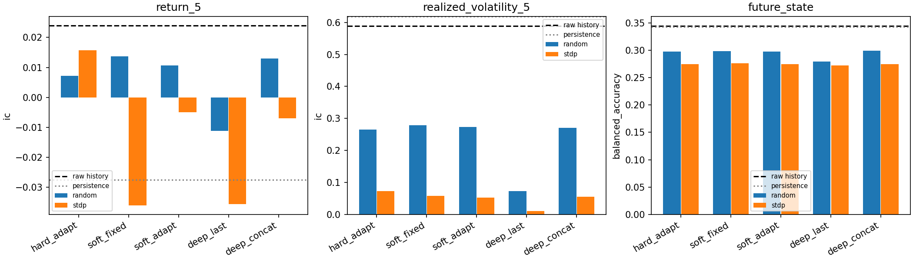
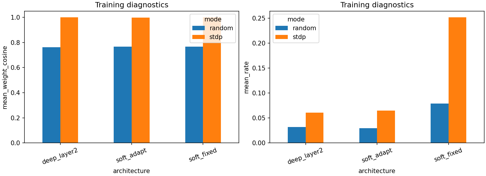

# v3：软抑制、自适应阈值与双层SNN结构消融

2026-10-28。该版本只回答网络结构问题；数据、特征、编码、11目标、线性读出和23段滚动与v2保持一致。**4—9月已观察，本轮仍是探索性历史检验。**版本与实验分工见[版本索引](../../VERSIONS.md)，上轮完整诊断见[v2报告](../v2/report.md)。

## 主要发现

- soft_adapt_stdp相对hard_adapt_stdp：未来实现波动IC差-0.0203，95%区间[-0.0522, 0.0068]，区间跨0。
- soft_adapt_stdp相对soft_fixed_stdp：未来实现波动IC差-0.0050，95%区间[-0.0153, 0.0061]，区间跨0。
- deep_last_stdp相对soft_adapt_stdp：未来实现波动IC差-0.0419，95%区间[-0.0558, -0.0289]，区间低于0。
- deep_concat_stdp相对soft_adapt_stdp：未来实现波动IC差0.0019，95%区间[0.0009, 0.0030]，区间高于0。

原始特征的实现波动IC为0.5894，直接用当前5分钟实现波动预测未来的持续基线IC为0.6185。即使某个结构超过原来的STDP，也须检查它是否超过匹配随机网络、原始特征和简单持续性；改善旧网络不等于新增金融信息。没有用本轮结果事后挑一个交易策略。

## 1. 固定项与结构编号

同一15900条预测、106有效日、115包日期；40有效日训练、随后10日验证、后5包日期预测，共23段。3种子104/211/307。12特征→正负24通道→每分钟8仿真步、12分钟96步；rate编码、训练缩放、3轮、批128、学习率和STDP行归一化均固定。11目标是收益、绝对收益、实现波动各1列，当前/未来四状态各4列。未来标签只用于监督Ridge读出和事后评价。

|编号|模型|作用|
|---|---|---|
|N0|hard_adapt，64硬竞争+自适应阈值|复用v2已锁预测|
|N1|soft_adapt，64软抑制+自适应阈值|与N0比较竞争方式|
|N2|soft_fixed，64软抑制+固定阈值|与N1比较阈值作用|
|N3|64→32软抑制+自适应阈值|第一层复用N1并冻结，训练第二层|

N3的deep_last读取第二层96维，deep_concat拼接两层288维；它们共享同一神经模型。单层输出192维，均为全窗发放、末3分钟发放和末态膜电位。每种结构都有相同种子的随机突触对照；随机模型按相同规则适配阈值。新增第二层也增加参数和表示维度，因此结果不完全等同于纯深度效应。

## 2. 机制定义

旧网络已有0.15抑制项和训练期自适应阈值，但每步强制只保留一个winner。本版软抑制允许所有越阈值单元发放，随后对每个神经元减去0.15×其他发放单元数，再截断为非负；该同步侧抑制影响下一步膜电位，不强制最多一次发放。

阈值适配沿用theta←0.999theta+0.03×batch_mean(spike)，固定阈值消融theta始终0。预测期突触和theta均冻结，窗口间膜电位/迹清零；不是新的逐样本快速阈值或在线跨日适应。软抑制改变发放/塑性事件数量，没有匹配发放预算。

第二层确实以第一层64路脉冲作为输入，种子+10000、32神经元、突触行和4.8，第一层在第二层训练中不更新。是逐层无监督STDP，不使用反向传播或未来标签训练神经层。精确参数和公式见[协议](../../architecture_v3/PROTOCOL.md)。

参考本地BindsNET的[DiehlAndCookNodes](../../../bindsnet/bindsnet/network/nodes.py)中训练期阈值与one_spike开关，以及[模型](../../../bindsnet/bindsnet/models/models.py)中循环抑制的组织方式。本项目沿用自己的批平均阈值、同步代数抑制和既有STDP参数；没有导入该库或声称数值复现其模型。

## 3. 相同样本、相同线性读出结果

|模型|收益IC|绝对收益IC|实现波动IC|当前状态BA|未来状态BA|
|---|---|---|---|---|---|
|hard_adapt_random|0.0071|0.1224|0.2651|0.4725|0.2980|
|hard_adapt_stdp|0.0157|0.0247|0.0729|0.3830|0.2745|
|soft_fixed_random|0.0137|0.1297|0.2786|0.4612|0.2985|
|soft_fixed_stdp|-0.0361|0.0257|0.0576|0.2981|0.2762|
|soft_adapt_random|0.0107|0.1226|0.2728|0.4672|0.2982|
|soft_adapt_stdp|-0.0049|0.0189|0.0526|0.2824|0.2746|
|deep_last_random|-0.0112|0.0242|0.0725|0.3353|0.2794|
|deep_last_stdp|-0.0357|0.0004|0.0107|0.2776|0.2722|
|deep_concat_random|0.0129|0.1203|0.2698|0.4679|0.2991|
|deep_concat_stdp|-0.0069|0.0202|0.0545|0.2851|0.2749|
|raw_history|0.0240|0.3212|0.5894|0.5559|0.3449|
|counts_minute|0.0150|0.1116|0.2922|0.5199|0.2979|
|risk_control|-0.0299|0.3166|0.5606|0.3752|0.3425|
|persistence|-0.0275|0.2366|0.6185|1.0000|0.3431|

BA是四类平衡准确率，机会水平0.25；当前状态由已有价格定义，机械规则识别为100%，当前成绩不能当成提前预测。绝对收益与实现波动都是风险幅度，不能直接决定买卖方向。

## 4. 配对不确定性

|left|right|target|difference|ci_low|ci_high|
|---|---|---|---|---|---|
|soft_adapt_stdp|hard_adapt_stdp|absolute_5|-0.0058|-0.0256|0.0187|
|soft_adapt_stdp|hard_adapt_stdp|realized_volatility_5|-0.0203|-0.0522|0.0068|
|soft_adapt_stdp|hard_adapt_stdp|future_state|0.0001|-0.0082|0.0074|
|soft_adapt_stdp|soft_fixed_stdp|absolute_5|-0.0068|-0.0166|0.0014|
|soft_adapt_stdp|soft_fixed_stdp|realized_volatility_5|-0.0050|-0.0153|0.0061|
|soft_adapt_stdp|soft_fixed_stdp|future_state|-0.0016|-0.0042|0.0013|
|deep_last_stdp|soft_adapt_stdp|absolute_5|-0.0185|-0.0279|-0.0084|
|deep_last_stdp|soft_adapt_stdp|realized_volatility_5|-0.0419|-0.0558|-0.0289|
|deep_last_stdp|soft_adapt_stdp|future_state|-0.0024|-0.0070|0.0013|
|deep_concat_stdp|soft_adapt_stdp|absolute_5|0.0013|0.0002|0.0023|
|deep_concat_stdp|soft_adapt_stdp|realized_volatility_5|0.0019|0.0009|0.0030|
|deep_concat_stdp|soft_adapt_stdp|future_state|0.0003|-0.0004|0.0012|
|hard_adapt_stdp|hard_adapt_random|absolute_5|-0.0978|-0.1208|-0.0708|
|hard_adapt_stdp|hard_adapt_random|realized_volatility_5|-0.1922|-0.2230|-0.1544|
|hard_adapt_stdp|hard_adapt_random|future_state|-0.0235|-0.0313|-0.0144|
|hard_adapt_stdp|raw_history|absolute_5|-0.2965|-0.3521|-0.2229|
|hard_adapt_stdp|raw_history|realized_volatility_5|-0.5165|-0.5872|-0.4087|
|hard_adapt_stdp|raw_history|future_state|-0.0704|-0.0855|-0.0510|
|hard_adapt_stdp|persistence|absolute_5|-0.2119|-0.2862|-0.1091|
|hard_adapt_stdp|persistence|realized_volatility_5|-0.5456|-0.6461|-0.3745|
|hard_adapt_stdp|persistence|future_state|-0.0686|-0.0870|-0.0450|
|soft_fixed_stdp|soft_fixed_random|absolute_5|-0.1040|-0.1250|-0.0738|
|soft_fixed_stdp|soft_fixed_random|realized_volatility_5|-0.2210|-0.2580|-0.1811|
|soft_fixed_stdp|soft_fixed_random|future_state|-0.0222|-0.0310|-0.0132|
|soft_fixed_stdp|raw_history|absolute_5|-0.2956|-0.3449|-0.2194|
|soft_fixed_stdp|raw_history|realized_volatility_5|-0.5318|-0.6074|-0.4216|
|soft_fixed_stdp|raw_history|future_state|-0.0687|-0.0843|-0.0491|
|soft_fixed_stdp|persistence|absolute_5|-0.2109|-0.2752|-0.1092|
|soft_fixed_stdp|persistence|realized_volatility_5|-0.5609|-0.6527|-0.4039|
|soft_fixed_stdp|persistence|future_state|-0.0669|-0.0867|-0.0426|
|soft_adapt_stdp|soft_adapt_random|absolute_5|-0.1037|-0.1261|-0.0776|
|soft_adapt_stdp|soft_adapt_random|realized_volatility_5|-0.2202|-0.2541|-0.1815|
|soft_adapt_stdp|soft_adapt_random|future_state|-0.0236|-0.0318|-0.0148|
|soft_adapt_stdp|raw_history|absolute_5|-0.3024|-0.3511|-0.2296|
|soft_adapt_stdp|raw_history|realized_volatility_5|-0.5367|-0.6123|-0.4242|
|soft_adapt_stdp|raw_history|future_state|-0.0703|-0.0854|-0.0508|
|soft_adapt_stdp|persistence|absolute_5|-0.2177|-0.2812|-0.1144|
|soft_adapt_stdp|persistence|realized_volatility_5|-0.5659|-0.6604|-0.4064|
|soft_adapt_stdp|persistence|future_state|-0.0685|-0.0873|-0.0443|
|deep_last_stdp|deep_last_random|absolute_5|-0.0238|-0.0342|-0.0118|
|deep_last_stdp|deep_last_random|realized_volatility_5|-0.0618|-0.0808|-0.0433|
|deep_last_stdp|deep_last_random|future_state|-0.0071|-0.0118|-0.0028|
|deep_last_stdp|raw_history|absolute_5|-0.3208|-0.3723|-0.2408|
|deep_last_stdp|raw_history|realized_volatility_5|-0.5787|-0.6582|-0.4624|
|deep_last_stdp|raw_history|future_state|-0.0727|-0.0905|-0.0512|
|deep_last_stdp|persistence|absolute_5|-0.2362|-0.3020|-0.1294|
|deep_last_stdp|persistence|realized_volatility_5|-0.6079|-0.7069|-0.4455|
|deep_last_stdp|persistence|future_state|-0.0709|-0.0897|-0.0463|
|deep_concat_stdp|deep_concat_random|absolute_5|-0.1001|-0.1205|-0.0740|
|deep_concat_stdp|deep_concat_random|realized_volatility_5|-0.2153|-0.2475|-0.1789|
|deep_concat_stdp|deep_concat_random|future_state|-0.0242|-0.0324|-0.0150|
|deep_concat_stdp|raw_history|absolute_5|-0.3010|-0.3505|-0.2284|
|deep_concat_stdp|raw_history|realized_volatility_5|-0.5349|-0.6092|-0.4236|
|deep_concat_stdp|raw_history|future_state|-0.0700|-0.0852|-0.0504|
|deep_concat_stdp|persistence|absolute_5|-0.2164|-0.2798|-0.1141|
|deep_concat_stdp|persistence|realized_volatility_5|-0.5641|-0.6584|-0.4047|
|deep_concat_stdp|persistence|future_state|-0.0682|-0.0873|-0.0438|

区间使用相同115包日期、5日块、1000次配对重抽样；没有重新训练bootstrap模型，也没有多重检验校正。所有模型和三个种子结果保留于metrics.csv、seed_metrics.csv、monthly_metrics.csv、paired_comparisons.csv，不根据本轮成绩重选结构、调参或改变滚动窗口。

## 5. 神经元是否学到了更多不同模式

|architecture|mode|平均权重余弦|平均有效秩|平均发放率|最少活跃神经元|
|---|---|---|---|---|---|
|deep_layer2|random|0.7626|1.8088|0.0317|32|
|deep_layer2|stdp|1.0000|1.1101|0.0610|32|
|soft_adapt|random|0.7676|7.9975|0.0297|64|
|soft_adapt|stdp|0.9975|1.1200|0.0649|64|
|soft_fixed|random|0.7676|6.7769|0.0792|64|
|soft_fixed|stdp|1.0000|1.1879|0.2519|64|

放电更多、活跃单元更多或权重变化更大，都不自动代表金融信息更多。权重余弦越接近1，输入权重方向越相似，可提示模式趋同；但这是训练诊断，不是因果证明。有效秩只对原始表示中心化，会受膜电位与发放率量纲影响，不等于可预测信息量。第二层的有效秩和第一层维度不同，也不能只比较绝对数值。

## 6. 版本边界及下一步

本轮已完成用户提出的结构扩展与逐项消融，**没有同时更换编码、特征、风险标签或止损规则**。滚动框架作为固定评估方式沿用。风险用途应另外检验：固定同一基础交易信号，比较无过滤、简单历史波动过滤、原始特征风险读出、STDP风险读出，在过去验证上选门槛，再检验净收益/回撤/尾部损失。动态止损还须处理分钟内价格路径和滑点；挂单成交概率则需适合的盘口/订单数据。

不能把v1绝对收益IC约0.16视为已经稳定确认的风险优势；v2全滚动该值约0.025。研究目标仍是STDP相对可用基线的增量价值，而不只是把最终输出改名为风险分数。新的确认需要更晚日期或其他独立数据。

## 7. 完成与复现

新增4项机制检查和原49项共53项通过。新训练414个层检查点（23段×3种子×2模式×3层配置），每段24个线性读出，共552个；deep_last/deep_concat共用第二层。三个普通进程按fold模3分工，输出互斥，无共享模型状态。

核验结果：{"all_sources_inputs_and_v2_artifacts_unchanged": true, "all_23_folds_causal": true, "all_model_hashes_freeze_and_reload": true, "new_layer_checkpoints": 414, "raw_to_forecast_cases_reproduced": 24}。

folds/fold_XX包含层权重、训练锁、读出/验证后锁、预测及表示；run_manifest记录源码与继承输入；verification、analysis_sources和artifact_manifest记录核验。读取和运行见[复现说明](../../architecture_v3/README.md)。v1、v2数据和产物均保留。
