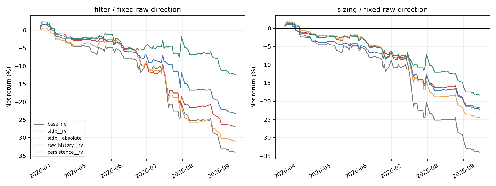
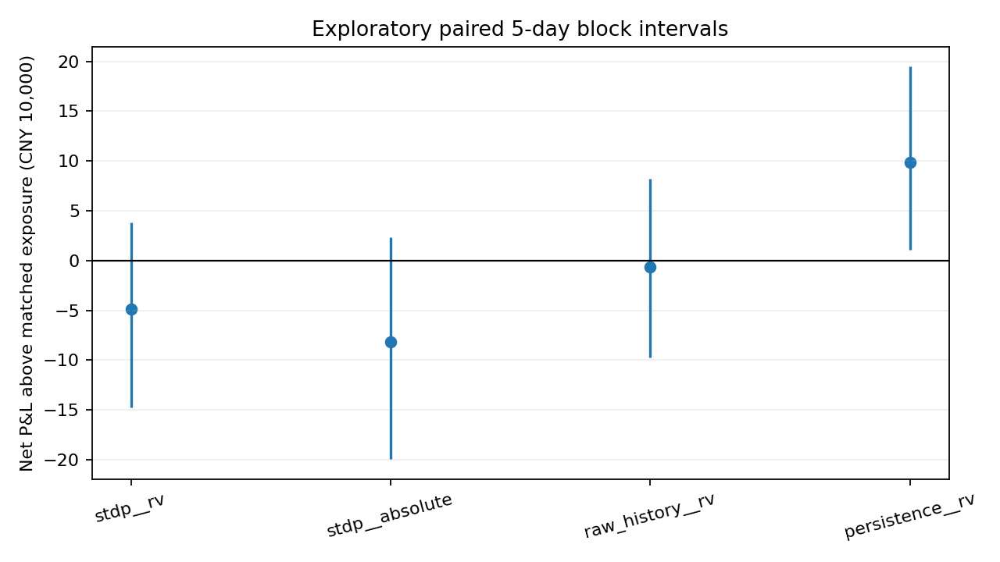

# v4：风险预测的开仓过滤与整数仓位实验

本轮将风险用途单独检验，复用v2全滚动SNN和Ridge读出。没有重新训练、改编码或加入止损。2026年4—9月已在前轮研究观察，以下是历史滚动探索，不是新独立测试。

## 已观察成果

- 开仓过滤（100万本金）：STDP实现波动控制后的净收益-26.93万元，无风险层为-34.06万元；最大回撤绝对值从35.54%降至28.47%，总手数保留69.2%。同暴露随机期望以上的差额为-4.89万元，95%日期块区间[-14.77,3.84]万元，跨零，尚未建立额外择机优势。简单当前波动持续基线净收益-12.35万元。
- 整数仓位（200万本金）：STDP实现波动控制后的净收益-43.68万元，无风险层为-67.98万元；最大回撤绝对值从35.48%降至23.31%，总手数保留69.4%。同暴露随机期望以上的差额为2.74万元，95%日期块区间[-4.49,12.09]万元，跨零，尚未建立额外择机优势。简单当前波动持续基线净收益-36.65万元。
- STDP绝对收益过滤主底座净亏30.94万元，弱于STDP实现波动过滤的点估计；辅助selected底座甚至由净亏24.80万元变为净亏29.42万元。终点幅度不是通用止损风险代理。
- 当前波动持续的过滤主底座超过同暴露随机期望9.83万元，区间[1.10,19.50]万元；辅助底座也有正差额。本轮可以看到简单波动过滤的有限积极证据，但自身仍净亏，且这些是已观察历史、未校正多重比较的探索结果。
- 全部88个预设组合（含基线、两方向、两成本）中，净盈利组合为0。主底座、单边1tick下，STDP实现波动与随机/原始/持续风险来源的配对收益差区间均跨零，不能因某个点估计更好而宣称STDP增量成立。
- 在672个主底座机会中，STDP波动预测与未来RV的IC约0.074、与方向MAE约0.069；当前波动持续基线分别约0.703和0.489。STDP过滤掉的207笔实现RV均值22.65bp，保留的465笔19.14bp，但被过滤机会平均单手净亏344元、保留机会净亏579元：过滤较高波动不等于剔除了最差净收益机会。
- 输出用途上优先RV→风险预算/仓位和过滤仍合理；当前实验不足以证明STDP比简单波动信息更合适。后续改善表示信息保留与风险校准，应独立于本版本应用参数，不能事后重选门槛来把本轮改成赢家。

## 哪种输出适合什么用途

|输出|适用用途|本轮处理|
|---|---|---|
|未来5分钟实现波动|路径起伏、风险预算与仓位调整；可检验开仓过滤|主目标|
|未来5分钟绝对收益|终点位移幅度；可能漏掉先跌后涨的风险|完整对照|
|当前/未来四状态|只有状态预测可靠、与策略收益对应时才可分状态交易|本轮不接入；v2未显示增量优势|
|未来5分钟收益|决定多空方向|方向底座保持既有预测|
|方向条件最大不利波动/触及阈值概率|更直接对应止损|当前没有该读出；未实施|

高波动不是高亏损概率。高波动也可能提供收益机会；降低波动暴露不自动增加净收益。绝对收益是终点幅度，RV是分钟采样路径的平方对数收益和开根号，仍无法完整描述分钟内部尾部走势。

## 数据、模型与因果流程

- 沿用明确IC合约分钟数据、12金融特征、12分钟窗口、24正负通道、8仿真步/分钟、64竞争LIF、192维表示、监督Ridge读出；3种子平均。STDP只做无监督表示。
- SNN和读出均来自v2既定40日训练/10日验证/5包日期预测，共23段、15900预测；每段重新初始化训练，非在线续训。本轮只加载这些检查点推理。
- 过滤和仓位所需标尺只用各段过去10日验证风险预测的分布，未来风险/收益不参与门槛或手数。验证期也曾用于Ridge超参数，不把其成绩当独立证明。
- 主方向底座为原始特征收益读出，固定既有方向和入场门槛；原底座属于诊断，允许最佳验证收益为负时交易。辅助selected底座按过去验证择原始/STDP/混合或空仓。
- 固定原机会时钟：跳过一笔后仍等待原虚拟5分钟持有结束再考虑下一笔，控制因为开仓时间变化引入的差异。没有持仓中的动态调仓。

## 固定风险规则与成交核算

过滤：风险预测≤过去验证预测80%分位才开1手，否则0手。基准固定1手、100万元本金。

仓位：`min(2, floor(2 × max(过去验证预测中位数,1bp) / max(当前风险预测,1bp)))`，只允许0/1/2手。基准固定2手、200万元本金，与单手方案初始杠杆一致；不同本金方案应比较收益率/回撤，而非直接比较亏损金额。它是相对风险缩仓，并非校准VaR。

门槛、上限和下限在运行前固定，没有搜索本轮收益最高的参数。所有组合均完整保留。方向信号后留一整分钟，开盘价模拟入场、持有5分钟、不跨午休/隔夜；乘数200、tick0.2、原手续费、单边1tick和2tick敏感性；订单固定费用每单一次，按实际手数计比例费用。资金连续，保证金约束实际检查。

## 主底座：固定原始特征方向

### 开仓过滤（100万元，单边1tick）

|风险来源|笔数|总手数|相对手数|净收益元|最大回撤%|日损失ES95元|超过同暴露随机期望元|差额区间下界|差额区间上界|
|---|---|---|---|---|---|---|---|---|---|
|无风险层|672|672|1.000|-340,560.856|-35.543|33,571.735|0.000|-0.000|0.000|
|STDP实现波动|465|465|0.692|-269,265.953|-28.471|23,850.425|-48,926.076|-147,710.460|38,393.033|
|STDP绝对收益|480|480|0.714|-309,415.162|-31.733|29,383.273|-82,041.100|-199,655.036|23,341.269|
|随机SNN实现波动|481|481|0.716|-277,944.611|-29.117|24,450.268|-53,365.022|-119,261.054|16,288.502|
|随机SNN绝对收益|507|507|0.754|-298,017.542|-31.364|27,729.863|-61,338.325|-161,423.453|45,911.704|
|原始特征实现波动|491|491|0.731|-232,424.955|-24.999|20,807.432|-6,361.849|-97,195.596|81,718.080|
|原始特征绝对收益|483|483|0.719|-199,925.960|-21.736|19,217.240|21,712.820|-71,931.780|118,328.912|
|原始+STDP实现波动|489|489|0.728|-220,578.758|-23.719|20,615.508|5,847.381|-82,310.369|109,860.048|
|原始+STDP绝对收益|491|491|0.731|-193,303.894|-21.177|17,630.237|30,067.711|-39,139.891|113,551.200|
|当前波动持续|486|486|0.723|-123,461.806|-14.811|19,265.418|98,306.707|10,989.285|194,981.809|
|当前绝对收益持续|501|501|0.746|-149,502.442|-17.475|18,237.253|89,919.346|4,566.168|183,945.297|

### 整数仓位（200万元，单边1tick）

|风险来源|笔数|总手数|相对手数|净收益元|最大回撤%|日损失ES95元|超过同暴露随机期望元|差额区间下界|差额区间上界|
|---|---|---|---|---|---|---|---|---|---|
|无风险层|672|1344|1.000|-679,777.713|-35.480|67,114.471|0.000|-0.000|0.000|
|STDP实现波动|672|933|0.694|-436,846.777|-23.314|43,135.321|27,351.052|-44,874.713|120,863.129|
|STDP绝对收益|672|944|0.702|-490,518.395|-26.077|50,113.896|-29,438.436|-148,711.781|85,678.889|
|随机SNN实现波动|672|953|0.709|-473,308.592|-25.287|45,473.847|-23,858.572|-84,785.727|35,107.882|
|随机SNN绝对收益|672|963|0.717|-448,725.027|-23.585|43,669.358|20,038.865|-48,226.633|129,543.133|
|原始特征实现波动|670|968|0.720|-444,734.348|-23.562|39,672.458|8,980.535|-67,293.674|97,290.739|
|原始特征绝对收益|670|976|0.726|-496,387.621|-26.122|43,486.765|-30,293.904|-130,595.404|73,332.355|
|原始+STDP实现波动|670|966|0.719|-451,229.173|-23.881|40,399.592|-629.468|-85,361.058|92,278.143|
|原始+STDP绝对收益|669|977|0.727|-494,857.475|-25.925|41,168.579|-31,007.047|-141,203.727|88,060.257|
|当前波动持续|619|941|0.700|-366,513.781|-20.202|34,661.033|70,300.131|-41,099.015|207,103.610|
|当前绝对收益持续|498|811|0.603|-196,327.771|-12.182|31,268.555|201,904.315|41,107.554|391,816.535|

## 如何区分预测有效与单纯少交易

同暴露随机控制在每个滚动段固定机会中打乱0/1/2手分配，保留该段实际交易笔数和总手数。其期望净收益是同样交易量随机选择机会的参照。真实净收益减这个期望，才更接近风险排序是否选对机会的检验。该控制使用事后暴露做归因，不能部署，也不参与实际规则选择。

表中差额区间使用5包日期块、1000次重抽样；同时保存1000次手数打乱参照。区间属于探索性分析，未作多重比较修正，不应事后从多个候选中挑一个称正式赢家。随机参照不复算路径保证金；实际保证金拒绝情况见核验。少亏、回撤降低、净盈利、超过简单风险基线是不同结论。空仓始终是0收益/0交易风险对照。

## 辅助selected方向底座（单边1tick）

|风险来源|笔数|总手数|相对手数|净收益元|最大回撤%|日损失ES95元|超过同暴露随机期望元|差额区间下界|差额区间上界|
|---|---|---|---|---|---|---|---|---|---|
|无风险层|621|621|1.000|-247,990.911|-25.652|33,571.735|0.000|-0.000|0.000|
|STDP实现波动|464|464|0.747|-234,802.679|-24.148|23,968.943|-40,304.843|-127,484.247|33,094.327|
|STDP绝对收益|471|471|0.758|-294,206.922|-29.991|29,383.273|-97,725.379|-210,708.872|-1,187.953|
|随机SNN实现波动|467|467|0.752|-210,099.020|-21.514|24,311.808|-16,347.135|-85,822.245|53,813.652|
|随机SNN绝对收益|486|486|0.783|-246,881.316|-25.542|27,729.863|-43,045.219|-135,427.334|50,918.988|
|原始特征实现波动|476|476|0.767|-181,083.840|-19.035|19,914.210|-14,348.801|-102,783.045|66,616.093|
|原始特征绝对收益|468|468|0.754|-160,696.760|-17.019|19,217.240|1,105.755|-97,629.972|89,292.159|
|原始+STDP实现波动|477|477|0.768|-168,227.100|-17.764|19,584.312|-1,067.104|-92,496.943|93,619.826|
|原始+STDP绝对收益|472|472|0.760|-154,964.876|-16.452|17,630.237|13,508.202|-55,819.328|88,055.938|
|当前波动持续|465|465|0.749|-54,065.001|-7.821|17,551.730|113,209.088|24,539.140|203,986.955|
|当前绝对收益持续|471|471|0.758|-131,671.785|-14.230|18,884.157|48,841.756|-50,776.587|138,353.930|

辅助底座部分时段本身使用STDP方向，因此主归因以原始方向底座为准。原始+STDP风险读出也不等于STDP单独有效；需要与原始风险读出相比较。

## 滑点敏感性

|应用|风险来源|2tick净收益元|收益率%|最大回撤%|
|---|---|---|---|---|
|filter|无风险层|-394,322.761|-39.432|-40.626|
|filter|STDP实现波动|-306,466.806|-30.647|-31.977|
|filter|STDP绝对收益|-347,816.255|-34.782|-35.413|
|filter|原始特征实现波动|-271,706.007|-27.171|-28.647|
|filter|当前波动持续|-162,343.032|-16.234|-18.339|
|sizing|无风险层|-787,301.522|-39.365|-40.561|
|sizing|STDP实现波动|-511,489.005|-25.574|-26.841|
|sizing|STDP绝对收益|-566,040.648|-28.302|-29.597|
|sizing|原始特征实现波动|-522,176.848|-26.109|-27.229|
|sizing|当前波动持续|-441,796.058|-22.090|-23.671|

## 核验与可复现产物

- 新增6项测试及既有53项回归，记录见[tests.log](tests.log)。23段重建预测最大绝对误差为3.33e-16。
- 共88种应用/基线/方向/成本组合；全部整数手数；单手不加风险层逐分钟净值与旧回测一致（最大误差见verification.json）。最大保证金拒绝数0。
- 已核对旧版本4948项产物哈希未变。未改原数据、模型或旧报告；本轮代码/协议与原模型来源单独记录。
- [summary.csv](summary.csv)：全部净收益、回撤、ES、同暴露比较。
- [monthly.csv](monthly.csv)：逐月损益与选择差额；[paired_comparisons.csv](paired_comparisons.csv)：STDP与其他风险来源的配对收益差。
- [opportunity_prediction_metrics.csv](opportunity_prediction_metrics.csv)：真实机会上的RV、绝对收益和方向MAE关联；[kept_skipped_diagnostics.csv](kept_skipped_diagnostics.csv)：保留/过滤机会的实现风险。
- calibration/保存每折历史预测、未来预测、门槛和标尺；backtests/保存每笔机会（含0手）、逐日与逐分钟资金。
- [verification.json](verification.json)、[prepared.json](prepared.json)、[source_lock.json](source_lock.json)记录重建与完整性核验。

运行：`PYTHONPATH=independent_study OPENBLAS_NUM_THREADS=2 OMP_NUM_THREADS=1 .venv/bin/python -m risk_v4.prepare`，再运行`risk_v4.run`、`risk_v4.report`。不得把旧结果目录覆盖作为新实验。

## 限制与后续边界

行情分钟标签、供应商价格调整/数量单位等仍未获确认，成交按分钟开盘价加滑点模拟；这里不能推断真实挂单成交概率。没有tick盘口，也没有止损触发/成交实验。

止损后续应独立学习持仓方向条件的最大不利波动、损失分位数或触及阈值概率，并核实分钟内触价与成交规则。不能把未来RV预测乘一个常数便称已验证的止损模型，也不能简单把高波动对应更紧止损。新参数、模型或交易用途的最终确认需要未观察数据。
