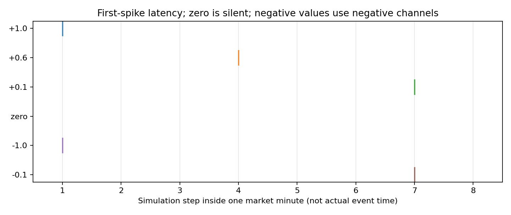
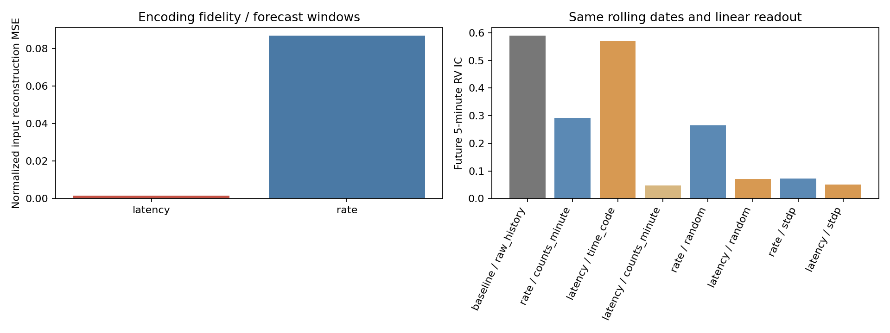

# v5：8步首脉冲延迟编码与Rate的滚动对照

本轮只改编码。新候选使用确定性First-Spike Latency，旧Rate冻结作对照。数据、特征、网络、读出、目标和23段滚动日期保持一致；本轮没有修改交易策略或运行新的交易回测。所有4—9月历史已观察，以下不是全新独立测试。

## 核心观察

- 归一化输入重建MSE：Rate 0.086782，Latency 0.001656。这是编码保真，不能单独当作金融有效性的证明。
- 首脉冲时间直接读出的未来实现波动IC 0.569458；Rate逐分钟计数直接读出0.292214；原始特征0.589372。
- Latency随机SNN风险IC 0.070361，Latency STDP 0.051303；旧Rate STDP 0.072904。必须同时检查STDP相对匹配随机与原始特征的增量，不能只对弱旧版本取胜。
- 编码直接读出：Latency时间码相对Rate计数：RV IC差+0.277244，95%区间[+0.205250,+0.330683]；区间为正，有探索性改善证据。
- 网络最终预测：Latency STDP相对Rate STDP：RV IC差-0.021601，95%区间[-0.056303,+0.014155]；区间跨零，未建立稳定差异。
- 学习增量：Latency STDP相对同编码随机SNN：RV IC差-0.019058，95%区间[-0.032742,-0.007163]；区间为负，观察到退步。
- 组合增量：原始+Latency STDP相对原始特征：RV IC差-0.015793，95%区间[-0.025612,+0.000547]；区间跨零，未建立稳定差异。
- 这次定位显示：时间码直接读出保留了较强风险信息，但进入现有SNN后，无论随机还是STDP，风险可读性均明显变弱；不能把问题只归结为Rate随机噪声或STDP训练轮数。现有192维表示以发放率和末膜电位为主，没有显式记录隐藏神经元首脉冲时刻。时刻读出与神经动力学匹配应作为下一项独立对照，当前结果不能单独判定是哪一项导致退步。
- 具体改善与不确定性见下面配对区间；编码先后、市场先后和金融因果是三个不同层次。

## 编码定义与时间含义

每折用原v2训练期缩放，得到z∈[-1,1]。正负分通道a=max(±z,0)，a=0不放电；a>0时`k=floor(7×(1-a)+0.5)`，k为0—7。幅度1在第1步、0.1在第7步；每分钟每个非零特征在对应符号通道最多一个脉冲。市场分钟块仍按时间顺序排列。

8个槽只有8档幅度时间精度，解码a≈1−k/7的误差最多1/14；很小非零值虽可解码成0，但编码还区分有脉冲和静默。时间码直接读出采用(8−k)/8，无脉冲为0，保留槽位和存在性。

对于Rate，a=0.1时每步概率0.03、8步期望仅0.24个脉冲，整分钟没有脉冲概率0.97^8≈0.784。Latency消除随机漏发，但近零值也发一次，会改变总输入电流、同步性和竞争。固定神经动力学下的比较不能把所有变化归因于Timing，也不能视为所有编码各自充分调优后的上限比较。

Latency中“大幅度先发”是人工幅度映射；当前分钟OHLC需分钟结束才可得，不能据此宣称发现分钟内哪个市场事件导致另一个。Rate本来也有STDP使用的pre/post时间差。Delta编码主要表达相邻输入变化，与幅度编码的语义不同，未混入本轮。

## 数据、网络、读出与滚动

- 同一15900预测样本/23段：40有效日训练、10日验证、5包日期预测。SNN与读出每段重训，三种子104/211/307。沿用IC真实合约底表和12金融特征、12分钟窗口。
- 24输入通道→96仿真步→64硬竞争自适应LIF；STDP 3轮。神经表示为64全窗发放率+64末3分钟发放率+64末膜电位，共192维。网络参数不为新编码调优。
- 随机权重不更新，阈值仍按相同规则适配；匹配STDP训练。新增138金融SNN、253金融Ridge读出，未来标签只用于读出和评价，不反传SNN。
- 11输出：收益/绝对收益/实现波动各1，当前/未来各4状态分数。主目标实现波动；完整报告其他目标避免选择性展示。
- 首脉冲时间码与逐分钟计数各288维直接读出；它们分别保留时间槽/存在性，以及符号/存在性。Latency计数不保留幅度。同一Ridge超参数网格及历史验证选择。
- 编码时间直接读出是诊断，未经过SNN，不能把它的效果归功于STDP。原始+LatencySTDP的组合与原始对照用于检验增量。

## 输入重建与输入活动量

|encoding|mse|mae|input_spikes_per_minute|small_input_no_spike_fraction|
|---|---|---|---|---|
|latency|0.001656|0.034744|11.955524|0.000000|
|rate|0.086782|0.230202|10.492191|0.886115|

MSE在每折因果缩放并裁剪后的输入上计算。Rate采用每分钟计数/(8×0.3)再裁剪到[0,1]，正负通道恢复符号；未裁剪误差也保存在fidelity.csv。表中按预测样本数加权，Rate同时平均3种子；小幅值指0<|z|≤0.1，按相应元素数量加权。

## 同日期预测结果

|arm|representation|return_5|absolute_5|realized_volatility_5|
|---|---|---|---|---|
|baseline|persistence|-0.027465|0.236583|0.618548|
|baseline|raw_history|0.024041|0.321232|0.589372|
|latency|counts_minute|0.038741|0.006422|0.047306|
|latency|random|0.019983|0.021568|0.070361|
|latency|raw_plus_stdp|0.016958|0.316761|0.573580|
|latency|stdp|0.012702|0.024039|0.051303|
|latency|time_code|0.020871|0.307618|0.569458|
|rate|counts_minute|0.015028|0.111581|0.292214|
|rate|random|0.007141|0.122432|0.265141|
|rate|raw_plus_stdp|0.016996|0.322016|0.584604|
|rate|stdp|0.015667|0.024682|0.072904|

## 未来实现波动的配对差异

|left|right|target|difference|low|high|
|---|---|---|---|---|---|
|latency__stdp__linear|rate__stdp__linear|realized_volatility_5|-0.021601|-0.056303|0.014155|
|latency__random__linear|rate__random__linear|realized_volatility_5|-0.194780|-0.235426|-0.143959|
|latency__stdp__linear|latency__random__linear|realized_volatility_5|-0.019058|-0.032742|-0.007163|
|latency__stdp__linear|baseline__raw_history__linear|realized_volatility_5|-0.538069|-0.610074|-0.440330|
|latency__raw_plus_stdp__linear|baseline__raw_history__linear|realized_volatility_5|-0.015793|-0.025612|0.000547|
|latency__time_code__linear|rate__counts_minute__linear|realized_volatility_5|0.277244|0.205250|0.330683|
|latency__time_code__linear|latency__counts_minute__linear|realized_volatility_5|0.522152|0.423724|0.597150|
|latency__stdp__linear|latency__time_code__linear|realized_volatility_5|-0.518155|-0.591255|-0.421649|
|latency__stdp__linear|baseline__persistence__rule|realized_volatility_5|-0.567245|-0.676424|-0.391042|

5包日期块、1000次配对重抽样，区间属于探索性且未作多重比较修正。所有连续目标完整区间见paired_comparisons.csv；状态与逐月/种子指标也保留。不得事后选最好月份或种子作结论。

## 神经活动诊断

|mode|active_neurons|mean_rate|mean_weight_cosine|effective_rank|
|---|---|---|---|---|
|random|64.000000|0.014846|0.767566|61.080978|
|stdp|64.000000|0.014840|0.987368|49.280254|

effective_rank针对未标准化混合量纲表示，不能解释成全部信息维数。权重相似、活跃数量、放电量与金融预测需联合判断。

## AB/BA已知时序任务

|encoding|gap_minutes|representation|accuracy|
|---|---|---|---|
|latency|1|counts_minute|1.000000|
|latency|1|counts_total|0.500000|
|latency|1|random|0.526250|
|latency|1|raw_history|1.000000|
|latency|1|stdp|0.609167|
|latency|1|time_code|1.000000|
|latency|5|counts_minute|1.000000|
|latency|5|counts_total|0.500000|
|latency|5|random|0.618750|
|latency|5|raw_history|1.000000|
|latency|5|stdp|0.883750|
|latency|5|time_code|1.000000|
|rate|1|counts_minute|0.996250|
|rate|1|counts_total|0.500000|
|rate|1|random|0.792500|
|rate|1|raw_history|1.000000|
|rate|1|stdp|0.779167|
|rate|5|counts_minute|0.995833|
|rate|5|counts_total|0.500000|
|rate|5|random|0.894167|
|rate|5|raw_history|1.000000|
|rate|5|stdp|0.899167|

训练/验证/测试600/200/400对，间隔1或5分钟。AB和BA全窗计数及最后3分钟脉冲逐项相同。新12合成SNN，36线性读出；Rate只取v2相同线性设置。准确率高说明能够区分这类已知顺序，不等于市场因果或交易有效。

## 核验与复现

- 65项测试通过；新增138金融SNN、253金融读出，12合成SNN和36合成读出。随机权重冻结、推理参数冻结、每折模型复载均核对。
- 33组原窗口→编码→模型→读出重建通过；最大预测差6.66e-16。全部23折日期因果与文件哈希核验。
- 旧v1—v4共5255项产物及输入源代码未变。
- [复现说明](../../encoding_v5/README.md)、[固定协议](../../encoding_v5/PROTOCOL.md)、[测试](tests.log)、[核验](verification.json)。
- [指标](metrics.csv)、[配对区间](paired_comparisons.csv)、[逐月](monthly_metrics.csv)、[种子](seed_metrics.csv)、[保真](fidelity.csv)、[神经诊断](neural_diagnostics.csv)。
- folds/保存每折缩放、模型、锁、预测和表示；synthetic/保存已知答案实验。新预测与旧Rate严格对齐。

本轮未运行新的交易回测，不能由风险IC直接推断收益。若编码改进只发生在直接读出、经过STDP后又变弱，应继续定位神经竞争与可塑性；若变化随种子/月份不稳，也需未观察数据确认。动态止损、Delta、更多仿真步数与新网络仍为独立研究。
