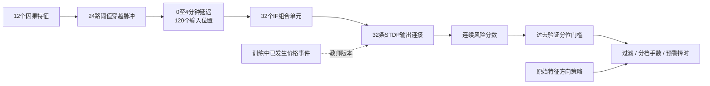
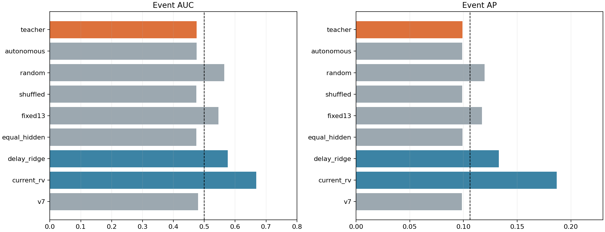
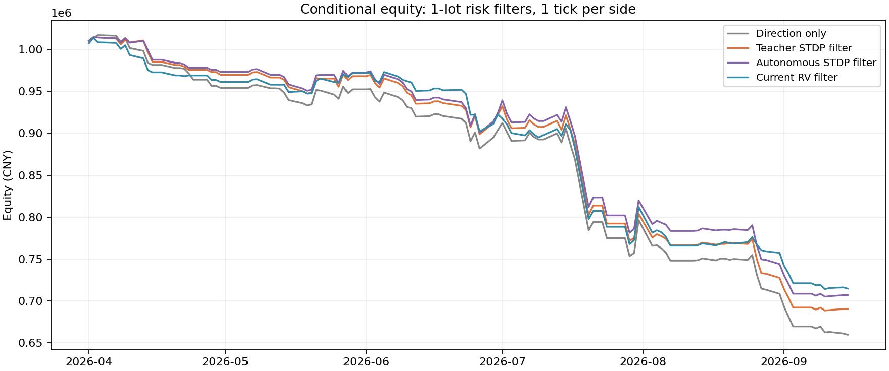

# v8金融信号与交易应用报告

已完成“真实分钟特征→延迟隐藏层→事件/自主STDP输出→风险信号→条件交易”的全流程。**新结构在本轮真实金融数据上没有建立可靠事件预测增量，90组固定交易评价没有净盈利。** 过滤或缩仓减少亏损，但同覆盖范围、同暴露的随机控制没有确认主模型的选时优势。不能把之前合成序列成功当成金融有效。

主模型事件AUC 0.4756、AP 0.0992，当前波动基线AUC 0.6688。1手过滤净亏 309,840.35元，无风险层净亏 340,560.86元；少亏 30,720.51元，但对应配对区间[-9,117, 74,125]跨零。该结果仍不构成可采用的盈利策略。

## 1. 本次实际完成了什么

- 23段40日训练/10日验证/5包日期预测，2026-04-01—09-15，共18868个有效分钟，其中15540个静默事件评价时点，与v7严格对齐。
- 69个训练隐藏层、69个冻结随机隐藏对照、345组输出STDP权重、23个同延迟监督Ridge，训练约280.2秒。每折重新初始化，预测时冻结。
- 9风险模型/对照×3用途×3执行情景，加各用途基准，共90组条件回测；固定672个原方向机会，60480条逐机会记录独立核账。
- 事件预测、独立事件提前量、交易持有期波动/不利路径、同暴露及同覆盖随机控制、成本/延迟压力、报告与原始产物已保存。动态止损及盘口挂单没有实施。

## 2. 数据、特征、编码与结构

只读原真实合约底表43440分钟，字段含上海时区datetime、contract_id、OHLC、volume、open_interest、segment_id和来源标记；沿用原前一包日OI合约选择及12项因果特征。具体为1/3分钟变化相对ATR、5分钟路径效率、支撑/阻力距离、收盘位置、短长波动比、振幅比、成交量异常、持仓变化、波动水平和已知日内时钟。它们是候选特征，不预先假定预测性。

每项特征训练20/80分位的低/高穿越形成两路脉冲，共24路。每路保留过去0—4分钟的延迟支路，共120个二值输入位置；跨日、午休、合约或缺分钟清空。隐藏层32个窗口独立IF组合单元，每个120条输入突触，输入→隐藏共3840条连接；隐藏→输出32条连接。

隐藏训练复用竞争诱发post的STDP增强和入权重总量约束变体，不读取事件标签；不是自由运行LIF成对STDP。推理单窗积分、阈值发放并重置，时间记忆由延迟支路提供。

真实数据每个5分钟输入窗平均有10.08个脉冲，远比合成的2个密集且分散。主版本每个隐藏阈值取训练驱动90%分位，并严格大于单连接最大权重；平均阈值0.4531，训练平均发放率10.00%、预测9.43%。随机对照也按自身训练驱动校准活动量，没有利用事件标签或预测结果设阈值。

原合成固定阈值1.3完整保留为对照，真实预测发放率仅0.000301%，几乎沉默；它只有极少告警，不能因为合并AUC略高于0.5就视为有用信号。其跨折零值/标尺细微差异也可能影响合并排序。主版本每折/种子预测均32个单元活跃，平均权重余弦0.2373；活跃和多样性本身不能证明金融预测有效。

## 3. 输出到底是什么，是否有监督

主风险分数为三种子平均：`S(t)=mean_seed(sum_j output_weight[j] × hidden_spike[j,t])`。它是一个加权响应数值，没有涨跌方向，不是事件发生概率。

教师事件仍为绝对1分钟对数收益超过训练95%分位且此前5分钟无突破。教师版只用训练历史的实际事件当post，隐藏脉冲当pre，按1—5分钟先后增减输出权重；隐藏先学组合，教师再给组合赋事件权重。这是事件教师驱动的混合学习，价格事件没有反传更新隐藏连接。

本轮同时完成autonomous对照：输出IF根据当前加权隐藏输入自主发放，STDP配对使用近期内部脉冲，输出阈值只按无标签活动量适配。该路不读取价格事件训练权重，但是否对应风险仍须用事件事后评价。没有偷偷将它称作教师版或宣称自主输出天然代表价格事件。

其他对照包括随机隐藏、错配事件教师、等权输出、固定1.3、同120维延迟输入监督Ridge、当前5分钟波动，以及复载原v7。所有模型使用同一目标、日期和评价样本。

主模型分数与等权隐藏发放分数的整体相关为0.9934，各折平均0.9957；教师权重均值0.3872、神经元间标准差均值0.0617。这提示当前教师加权后排序仍主要跟随隐藏活动量，不足以证明两者信息完全相同。

## 4. 真实事件预测与提前量

当前最近5分钟无阈值突破时，预测未来1—5分钟事件；实际正例比例10.62%。分数用过去验证分布的经验中秩分位统一展示，恒定分数不会被当成概率1；告警按原始分数严格大于过去验证80%分位。

|模型|AUC|AP|告警精确率|告警覆盖率|
|---|---:|---:|---:|---:|
|新隐藏层＋事件教师STDP|0.4756|0.0992|9.92%|20.44%|
|新隐藏层＋自主输出STDP|0.4750|0.0990|9.88%|20.51%|
|随机隐藏层＋事件教师|0.5646|0.1198|8.53%|13.06%|
|新隐藏层＋错配事件教师|0.4743|0.0988|9.65%|20.46%|
|新隐藏层固定1.3阈值|0.5457|0.1173|0.00%|0.03%|
|新隐藏层＋等权输出|0.4745|0.0990|9.53%|19.18%|
|相同延迟输入监督Ridge|0.5760|0.1329|13.56%|19.74%|
|当前5分钟波动|0.6688|0.1869|20.78%|18.92%|
|旧v7直接教师STDP|0.4802|0.0987|9.70%|20.10%|

AUC随机约0.5，AP参照10.62%的正例比例。主模型没有超过自主/等权/错配输出，弱于同延迟监督和当前波动；相对旧v7没有确认改善。主模型在405个可评价事件中命中163个，覆盖40.25%；已命中事件最早提前中位4分钟，不能忽略漏报而只展示提前量。完整537个事件含因预热等原因没有有效提前决策点的记录。

5日块1000次配对95%区间（教师版减对照，探索性，未作多重比较校正）：

|对照|指标|差值|区间|
|---|---|---:|---|
|新隐藏层＋自主输出STDP|auc|0.0006|[-0.0008, 0.0021]|
|新隐藏层＋自主输出STDP|ap|0.0002|[-0.0002, 0.0006]|
|随机隐藏层＋事件教师|auc|-0.0890|[-0.1862, -0.0046]|
|随机隐藏层＋事件教师|ap|-0.0207|[-0.0498, -0.0048]|
|新隐藏层＋错配事件教师|auc|0.0013|[-0.0002, 0.0027]|
|新隐藏层＋错配事件教师|ap|0.0004|[-0.0000, 0.0009]|
|新隐藏层固定1.3阈值|auc|-0.0701|[-0.1473, 0.0153]|
|新隐藏层固定1.3阈值|ap|-0.0182|[-0.0432, 0.0005]|
|新隐藏层＋等权输出|auc|0.0010|[-0.0007, 0.0028]|
|新隐藏层＋等权输出|ap|0.0002|[-0.0004, 0.0005]|
|相同延迟输入监督Ridge|auc|-0.1004|[-0.1347, -0.0647]|
|相同延迟输入监督Ridge|ap|-0.0337|[-0.0554, -0.0173]|
|当前5分钟波动|auc|-0.1932|[-0.2382, -0.1468]|
|当前5分钟波动|ap|-0.0877|[-0.1177, -0.0578]|
|旧v7直接教师STDP|auc|-0.0046|[-0.0196, 0.0114]|
|旧v7直接教师STDP|ap|0.0005|[-0.0035, 0.0052]|

各折事件频率明显漂移，部分折无正例，相关指标保留NaN；分折/月与种子结果均在CSV中，不根据本轮结果倒转分数或改选阈值。

## 5. 信号怎样变成交易

多空来自**已有v2全滚动原始特征收益预测**：预测正且超过原验证门槛做多，预测负且超过门槛做空。新STDP只改变是否接纳该机会及手数，没有提供新的方向预测。

保持原672个非重叠方向机会，被跳过的机会仍占用原虚拟5分钟时钟，不借此额外抢开下一笔。本次486个机会处于新事件目标适用的静默范围，另186个机会保持过滤/仓位基准，不用超出适用范围的分数调仓；高风险择时中无适用预警就不开仓。所有风险模型共享这一覆盖范围。它与v4对所有机会用RV缩仓的覆盖方式不同，不能直接拿v4盈亏判断本版退步幅度。

|用途|规则|本金与基准|
|---|---|---|
|低风险过滤|分数超过过去验证80%分位，跳过；否则原方向1手|100万，基准每机会1手|
|分档仓位|≤60%分位2手，60—80%之间1手，>80%分位0手|200万，基准每机会2手|
|高风险择时|仅有高风险预警时按原方向1手，其余0手|100万，基准每机会1手|

这是相对风险档位，不是把STDP分数直接当波动率去反比例分仓。没有事件方向时，风险高既可能意味着持仓获利也可能意味着亏损，因此三用途在运行前分别固定，保留全部结果。

以下为各仓位档第一次真实出现的机会（只按时间和当时风险选择例子，不按事后盈亏挑选）：

|信号时间|实际合约|原方向|STDP分数|过去60% / 80%门槛|分档仓位|
|---|---|---|---:|---|---|
|2026-04-01 10:23:00+08:00|IC2606|空|0.8386|1.1636 / 1.8847|2手|
|2026-04-01 13:49:00+08:00|IC2606|空|1.5345|1.1636 / 1.8847|1手|
|2026-04-01 14:11:00+08:00|IC2606|空|2.7337|1.1636 / 1.8847|0手|

信号在t收盘形成，基准按t+2的分钟bar open进场、t+7的open平仓，持有5分钟；按照暂用的分钟结束标记解释，信号后至少留出一完整分钟。无跨午休/隔夜/合约持仓。IC乘数200元/点、tick0.2点，单边1tick滑点；沿用研究费用假设：开仓0.000023、平今0.00023、另加经纪费率0.00001及每单1元。费用率是本项目假设，不是重新核实的账户实际费率。

原事件窗口t+1…t+5与交易持有区间不完全重合，因此还单独评价实际持有期风险，不能把预警命中率直接当止损收益。

## 6. 回测结果

表中“严格同暴露增量”将手数只在同折、同静默覆盖状态内随机置换，保持非适用时段不变；它比仅保持总交易量更能分离风险分数的选择作用。原同折总体置换也保留，补充过程见[归因核验说明](../../finance_v8/EVALUATION_NOTES.md)。

### 低风险过滤：100万，原1手

|模型|交易笔数 / 总手数|净盈亏（元）|最大回撤|严格同暴露增量（元）|95%区间|
|---|---:|---:|---:|---:|---|
|原方向策略，无风险层|672 / 672|-340,560.86|35.54%|0.00|[-0, 0]|
|新隐藏层＋事件教师STDP|582 / 582|-309,840.35|32.85%|8,743.03|[-27,194, 36,919]|
|新隐藏层＋自主输出STDP|578 / 578|-293,332.34|31.24%|21,452.54|[-16,761, 51,396]|
|随机隐藏层＋事件教师|619 / 619|-328,363.33|34.28%|-5,972.22|[-35,208, 20,573]|
|新隐藏层＋错配事件教师|579 / 579|-294,750.61|31.38%|20,937.46|[-16,050, 50,536]|
|新隐藏层固定1.3阈值|672 / 672|-340,560.86|35.54%|0.00|[-0, 0]|
|新隐藏层＋等权输出|585 / 585|-287,887.93|30.71%|27,149.53|[-16,018, 65,772]|
|相同延迟输入监督Ridge|575 / 575|-336,660.26|34.94%|-21,288.85|[-77,970, 34,982]|
|当前5分钟波动|575 / 575|-285,495.46|30.16%|19,512.66|[-40,672, 82,405]|
|旧v7直接教师STDP|581 / 581|-333,266.66|34.79%|-17,971.35|[-50,310, 8,409]|

### 分档仓位：200万，原2手

|模型|交易笔数 / 总手数|净盈亏（元）|最大回撤|严格同暴露增量（元）|95%区间|
|---|---:|---:|---:|---:|---|
|原方向策略，无风险层|672 / 1344|-679,777.71|35.48%|0.00|[-0, 0]|
|新隐藏层＋事件教师STDP|582 / 1058|-585,881.17|31.04%|17,706.30|[-64,696, 77,508]|
|新隐藏层＋自主输出STDP|578 / 1055|-548,105.30|29.23%|47,823.82|[-27,377, 104,346]|
|随机隐藏层＋事件教师|619 / 1238|-655,488.66|34.22%|-11,944.45|[-70,412, 41,153]|
|新隐藏层＋错配事件教师|579 / 1057|-547,522.37|29.28%|49,710.70|[-23,933, 102,627]|
|新隐藏层固定1.3阈值|672 / 1344|-679,777.71|35.48%|0.00|[-0, 0]|
|新隐藏层＋等权输出|585 / 1073|-550,921.99|29.33%|49,380.32|[-26,353, 109,931]|
|相同延迟输入监督Ridge|575 / 1052|-616,225.28|32.22%|-20,890.73|[-107,900, 72,974]|
|当前5分钟波动|575 / 1064|-589,546.92|30.68%|-3,634.20|[-112,418, 123,291]|
|旧v7直接教师STDP|581 / 1051|-625,288.71|32.55%|-29,521.84|[-97,088, 26,115]|

### 仅高风险时择时：100万，1手

|模型|交易笔数 / 总手数|净盈亏（元）|最大回撤|严格同暴露增量（元）|95%区间|
|---|---:|---:|---:|---:|---|
|原方向策略，无风险层|672 / 672|-340,560.86|35.54%|0.00|[-0, 0]|
|新隐藏层＋事件教师STDP|90 / 90|-30,720.51|3.57%|-8,743.03|[-36,919, 27,194]|
|新隐藏层＋自主输出STDP|94 / 94|-47,228.52|5.13%|-21,452.54|[-51,396, 16,761]|
|随机隐藏层＋事件教师|53 / 53|-12,197.53|1.63%|5,972.22|[-20,573, 35,208]|
|新隐藏层＋错配事件教师|93 / 93|-45,810.25|5.07%|-20,937.46|[-50,536, 16,050]|
|新隐藏层固定1.3阈值|0 / 0|0.00|-0.00%|0.00|[0, 0]|
|新隐藏层＋等权输出|87 / 87|-52,672.92|5.75%|-27,149.53|[-65,772, 16,018]|
|相同延迟输入监督Ridge|97 / 97|-3,900.60|3.14%|21,288.85|[-34,982, 77,970]|
|当前5分钟波动|97 / 97|-55,065.39|6.49%|-19,512.66|[-82,405, 40,672]|
|旧v7直接教师STDP|91 / 91|-7,294.19|2.37%|17,971.35|[-8,409, 50,310]|

主教师过滤少亏30,720.51元，但严格同暴露增量为8,743.03元，区间[-27,194, 36,919]。分档仓位净亏585,881.17元，相应2手基准净亏679,777.71元；两本金的绝对亏损不可混比。高风险择时只做90笔，仍净亏30,720.51元；回撤较小主要伴随大幅减少暴露，不能当预警已有效。

原1手基准毛收益仅5,081.05元，手续费291,881.91元、滑点53,760.00元；新教师过滤后毛收益-10,518.26元。因此当前既有方向机会的毛利不足覆盖成本，风险层也未改善机会选择到足以盈利，不能只把失败归于某一项手续费。

全部90组无净盈利；固定1.3的高风险择时因无交易为0，不是有效盈利。其他对照即使某项相对随机区间为正，也不代表净盈利或经独立未见数据确认；完整逐项差异保留，不事后换成最佳模型。

## 7. 成本/延迟与持有路径核对

主教师模型压力结果：

|执行情景|用途|净盈亏（元）|最大回撤|
|---|---|---:|---:|
|base|filter|-309,840.35|32.85%|
|base|sizing|-585,881.17|31.04%|
|base|timing|-30,720.51|3.57%|
|two_ticks|filter|-356,401.87|37.28%|
|two_ticks|sizing|-670,523.84|35.05%|
|two_ticks|timing|-37,920.89|4.19%|
|extra_minute|filter|-307,351.68|31.77%|
|extra_minute|sizing|-574,786.68|29.84%|
|extra_minute|timing|-14,351.48|2.14%|

extra_minute把入出场同时延后1分钟，仍持有5分钟，所有机会通过同一连续时段核验。风险分数/门槛不随成本情景重选。

486个适用交易机会的实际持有区间相关：

|模型|事后目标|Pearson|Spearman|
|---|---|---:|---:|
|新隐藏层＋事件教师STDP|held_rv|-0.0403|-0.0391|
|新隐藏层＋事件教师STDP|held_absolute_return|-0.0226|-0.0183|
|新隐藏层＋事件教师STDP|direction_mae|-0.0568|-0.0289|
|新隐藏层＋自主输出STDP|held_rv|-0.0453|-0.0471|
|新隐藏层＋自主输出STDP|held_absolute_return|-0.0260|-0.0162|
|新隐藏层＋自主输出STDP|direction_mae|-0.0518|-0.0233|
|当前5分钟波动|held_rv|0.4503|0.4858|
|当前5分钟波动|held_absolute_return|0.2209|0.2288|
|当前5分钟波动|direction_mae|0.2143|0.2039|

主教师分数未呈现有利的持有期波动或方向条件不利路径关系；当前波动与后续实现波动关系更强，但高波动与交易亏损不是同一概念。没有把此分数直接用作动态止损距离。

## 8. 验证、结论和文件

6项新接入/归因测试与19项复用机制/会计测试共25项通过。23折预处理、标尺、日期及源哈希核对；首/中/末3折×3种子的模型从原始窗口复载，验证/预测共54组模型输出最大差0。全部v7样本/标签/原始分数一致，110个v7/v8合成旧产物未变。

60480条逐机会独立按成交价、方向、手数、费用与滑点重算，最大差7.28e-12元；基准净值精确重现已有v2，所有情景保证金拒单为0。常数风险分数的相关系数显式保留NaN，不以0或虚假的好成绩替代。

这条新链路已经完整运行，但还不能作为已验证的交易信号。当前证据更支持继续定位“隐藏表示与事件目标的联系”：输入延迟的监督基线仍保留一些信息，教师输出与等权活动量高度相似，合成模式能力没有转化为金融预警优势。未来若改负反馈、目标或编码，应另立实验并寻找新留出数据，不能继续在本历史上调参后称独立验证。

本轮全为已观察历史的探索性滚动/条件执行模拟。真实分钟时间标签、价格调整和量单位仍未获供应商确认，执行使用bar open和假设成本，不能称已验证实盘。报告不回避负结果，也不将暂时少亏等同于盈利能力。

复现见[README](../../finance_v8/README.md)，运行前规则见[协议](../../finance_v8/PROTOCOL.md)。关键产物：[事件指标](event_metrics.csv)、[事件差异区间](event_paired_intervals.csv)、[全部交易汇总](trading_summary.csv)、[同模型配对收益](paired_trading_intervals.csv)、[逐月结果](trading_monthly.csv)、[持有期风险关系](held_path_metrics.csv)、[逐事件提前量](event_leads.csv)。folds/保存权重/标尺/验证预测，backtests/保存逐机会和资金曲线。
