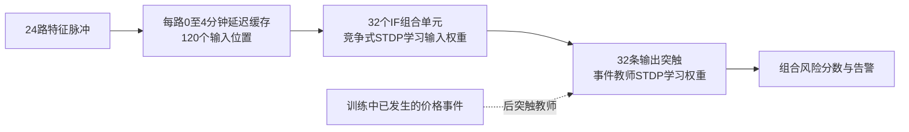

# v8 隐藏层时序组合：合成机制核验

**在本轮简化合成任务上，加入真实分钟延迟连接和竞争式STDP隐藏学习后，可以学出“A先出现、B两分钟后出现”的选择性响应，并用事件教师STDP赋予该组合更高的输出权重。** 三个种子均通过顺序、间隔与缺成分控制；没有使用实际金融数据，没有新的收益回测。v7金融结果仍冻结，不能将这份合成报告当作金融升级成功。

## 结构与训练职责



输入→隐藏学习“有哪些组合”，没有事件标签。隐藏→输出学习“哪个组合领先/滞后价格事件”，输出学习时隐藏权重冻结。事件教师不自动反传进入隐藏突触，主模型没有Ridge。若未来要让价格事件直接调制隐藏连接，需要资格迹/三因子学习等另一个明确机制。

延迟缓存只取过去：A(t−2)通过2分钟支路到达当前，B(t)通过0分钟支路到达当前。两条连接可以向同一隐藏单元提供共同驱动。所有0/1/2/3/4分钟支路均存在，学习器没有写死A、B通道或目标2分钟。

每个隐藏单元有120个输入权重，共3840个隐藏突触；隐藏到输出32条。推理为窗口独立的IF积分、阈值发放和重置，阈值1.3，单突触权重≤1；不是跨窗口连续膜电位LIF，时间记忆由延迟支路承担。多个单元可以同时响应，最后对它们的脉冲加权求和。

隐藏训练是**竞争诱发post的STDP增强＋权重总量约束变体**：对每个输入窗口，赢家先由驱动及使用量惩罚确定，再诱发post；到达的pre在内部处理顺序上先于post，活跃连接增强，随后按总量2归一化。频繁赢家受使用量惩罚。训练赢家放电不是通过自由运行推理阈值产生；也没有将内部处理先后伪称新的市场分钟因果。

输出复用v7真实1—5分钟有界成对STDP：初值0.5，领先增强、滞后减弱，3遍训练。实际分数是本次隐藏响应与输出权重的内积，本合成原型未叠加v7的跨分钟漏积分输出。验证期80%分位确定告警门槛。

## 可核查的学习结果

种子104的隐藏单元3，训练后最大的两条连接为A通道0、延迟2分钟，以及B通道1、延迟0分钟；以下全部是训练产生的权重：

|通道编号|延迟分钟|连接权重|
|---|---:|---:|
|0|2|0.950906|
|1|0|0.950906|
|6|4|0.001006|
|12|3|0.001005|
|16|3|0.000989|
|18|3|0.000984|

单个有效输入约0.951，小于1.3；两者一起约1.902，大于1.3。该单元在干净测试中只对A→B间隔2分钟发放，对间隔1/3、反序、同时、缺成分不发放。其他隐藏单元响应其他组合，并非整个隐藏层只响应目标。此单元的输出连接从0.5学到0.962445。挑出这个单元仅用于解释，预测使用全部32个单元，不按测试标签挑选单元。

```text
A 在 t−2 放电 ── 延迟2分钟 ── 权重约0.951 ──┐
                                             ├─ 当前合计约1.902 > 1.3 → 隐藏脉冲
B 在 t   放电 ── 延迟0分钟 ── 权重约0.951 ──┘
```

三个种子A/B/C/D分别位于[0,1,2,3]、[8,4,13,19]、[17,2,23,6]。各自重新训练，均找到3个目标响应单元，32个单元中24个活跃。没有检验“模型无需重训就适应新通道身份”。

## 合成样本与控制

每个样本恰有2个脉冲。8种模式：A→B间隔2（目标）、间隔1、间隔3、B→A间隔2、同时A/B、A+C、C+B、C+D。目标组合后1分钟设定事件，反序组合的事件在决策前2分钟，其余无事件。事件规则属于已知答案的生成器，不是金融标签发现。

每种子训练960、验证320、测试640个序列，决定时点随机平移；正式种子与开发序列独立。测试是相同8种模式的新出现时点，延迟后的干净输入仍只有8种模板，**不是大规模未知模式泛化检验**。因此不把重复模板数当成大量独立市场证据，也不据此计算夸大的显著性。

另给每个测试样本添加1个未参与A/B/C/D的通道脉冲，随机出现在此前0—4分钟。各类都添加同样数量的噪声，不靠脉冲数量判断正负。此噪声测试很有限，不覆盖时钟误差、丢失关键脉冲、真实金融密集噪声或分布漂移。

## 结果：严格相同A/B计数的子集

这里只保留前5类：A和B各一次，只改变顺序/间隔。目标比例20%，随机排序AUC0.5、AP0.2；种子顺序104/211/307。

|模型|干净AUC（三种子）|加无关脉冲AUC|干净AP（三种子）|
|---|---|---|---|
|训练后的延迟隐藏层+事件STDP|1.000/1.000/1.000|1.000/1.000/1.000|1.000/1.000/1.000|
|固定原阈值随机层（全沉默）|0.500/0.500/0.500|0.500/0.500/0.500|0.200/0.200/0.200|
|活动量匹配随机层+事件STDP|1.000/0.750/0.750|0.500/0.500/0.500|1.000/0.500/0.500|
|计数隐藏层+事件STDP|0.500/0.500/0.500|0.500/0.500/0.500|0.200/0.200/0.200|
|直接计数+事件STDP|0.500/0.500/0.500|0.500/0.500/0.500|0.200/0.200/0.200|
|延迟隐藏层+错配教师|0.250/0.750/0.750|0.250/0.750/0.750|0.250/0.500/0.500|

训练后的延迟网络在两种测试上均AUC/AP=1，预设门槛下命中率与召回均1。**活动量匹配随机层在一个干净种子上也AUC=1**，说明延迟结构本身能保留部分顺序信息，不能说只有STDP才具备表达能力；它在另两个种子为0.75，加入无关脉冲后均为0.5。固定阈值随机网络全沉默，是弱对照，不能单独据它宣称STDP优势。

计数隐藏层和直接计数均AUC0.5，符合它们在这个子集上输入完全相同的事实。错配教师AUC为0.25/0.75/0.75，不是每个种子恰好0.5；模式很少、仅三个种子，不能把这些数当严格的随机化显著性检验。

## 结果：全部8类

全样本目标比例12.5%；同样保留缺A/缺B控制。

|模型|干净AUC（三种子）|加无关脉冲AUC|干净AP（三种子）|
|---|---|---|---|
|训练后的延迟隐藏层+事件STDP|1.000/1.000/1.000|1.000/1.000/1.000|1.000/1.000/1.000|
|固定原阈值随机层（全沉默）|0.500/0.500/0.500|0.500/0.500/0.500|0.125/0.125/0.125|
|活动量匹配随机层+事件STDP|0.857/0.857/0.571|0.500/0.500/0.500|0.500/0.500/0.250|
|计数隐藏层+事件STDP|0.714/0.714/0.714|0.714/0.714/0.714|0.200/0.200/0.200|
|直接计数+事件STDP|0.714/0.714/0.714|0.714/0.714/0.714|0.200/0.200/0.200|
|延迟隐藏层+错配教师|0.429/0.714/0.714|0.429/0.714/0.714|0.200/0.333/0.333|

种子104的完整网络响应：

|模式|平均隐藏发放数|输出分数|告警比例|
|---|---:|---:|---:|
|A_B_gap2|3|2.887335|100%|
|A_B_gap1|3|1.500000|0%|
|A_B_gap3|3|1.500000|0%|
|B_A_gap2|3|0.235135|0%|
|A_B_simultaneous|3|1.500000|0%|
|A_C_gap2|3|1.500000|0%|
|C_B_gap2|3|1.500000|0%|
|C_D_gap2|3|1.500000|0%|

表中间隔1/3、同时、缺成分等没有后续事件的模式，其输出权重仍为初始0.5，3个单元合计1.5；反序模式因实际教师在前、隐藏脉冲在后而减权，分数约0.235。**普通STDP仍未增加“出现后没有事件”的负反馈。** 相同计数情况下，目标组合获得更高事件分数，但误报惩罚、背景频率校正仍是后续单独实验。

无告警时precision未定义，CSV保留NaN，不填成0或1。某对照在严格子集排序很好也可能未报警，因为告警门槛是在完整验证集上固定的；不能用AUC代替实际门槛决策。

## 核验、范围与复现

5项新机制测试和8项v7回归共13项通过；覆盖延迟的过去信息边界、相同计数控制、单脉冲不能跨阈值、隐藏不读取事件标签、教师先后索引。3个隐藏模型完整重训逐元素相同，18个输出复载预测精确相同。配置、训练源码、v7核心与旧结果哈希核验。

此次完成6个训练隐藏层（3延迟+3计数）、18个事件输出权重组，另3随机初始化对照。所有教师均只用于过去训练，测试分数不使用测试事件。没有训练真实金融隐藏层，没有新滚动金融指标或交易收益。

下一阶段才能把此结构接入v7分钟数据的相同事件和滚动日期，并增加同延迟输入的监督基线、随机网络、原v7和当前波动对照；同时检查真实密集脉冲是否导致过度发放或组合塌缩。合成可学、金融可预测、扣成本可盈利是三个独立问题。

运行方式见[README](../../sequence_v8/README.md)，设计见[DESIGN](../../sequence_v8/DESIGN.md)。原始结果包括[逐模式响应](pattern_responses.csv)、[全部指标](metrics.csv)、[学习到的连接](learned_patterns.json)和逐样本预测。
