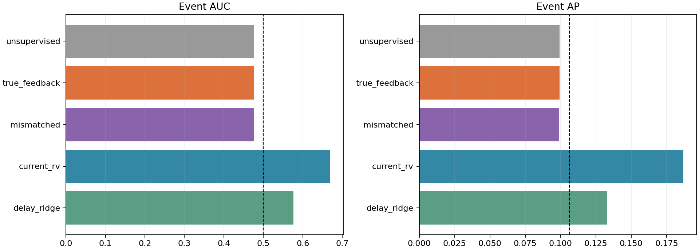
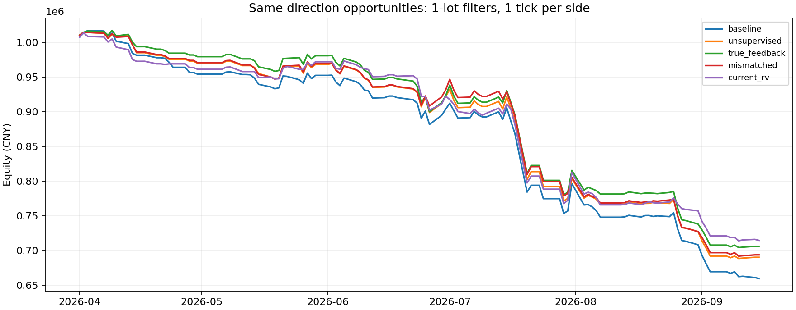

# v9：第一层事件调制资格迹，完整受控实验报告

23折、3种子、3组共207个隐藏模型和207个输出模型已完成。**本轮尚未确认真实事件反馈相对无反馈、错配反馈的稳定预测增量。** 主模型事件AUC 0.4767、AP 0.0993；真实反馈过滤净收益 -294,032.97元。共54组预设条件回测，净盈利组数0。结果不等于可部署策略。

## 1. 改了什么，保持了什么

仅第一层增加事件调制项；无反馈、真实反馈、错配反馈三组使用相同初始化、训练样本、随机顺序、3轮、延迟、32个隐藏单元、隐藏阈值规则和真实事件输出教师。第二层绝没有在错配组换成错配教师。无反馈69组权重/阈值/输出及23折预测精确重现v8，9个执行/应用组合的逐笔仓位及盈亏也重现v8教师模型。因而此次不是同时改网络、读出与策略。

每折40训练日、10验证日、5预测包日期，重置后重新拟合，不是权重持续接续的在线训练。2026-04-01—09-15共18868个有效预测分钟、15540个静默评价时点。三组完全共享日期、标的和目标；其中106个实际行情日。当前RV与同输入Ridge直接复用v8冻结结果。

## 2. 数据、特征、编码和结构

沿用标准真实IC合约底表选出的181日43440行：datetime（上海时区）、trading_date、contract_id、OHLC、volume、open_interest、bar_id、segment_id、来源审计字段。每天按此前包日期OI选择当日可用合约；合约/半日/缺口分段，特征不跨段混算。输入是已有因果特征表`results/v1/bars_features.parquet`，并非以主连价格当成交价。

12特征为：1/3分钟价格变化除以前20分钟ATR；5分钟方向效率；距此前20分钟最高/最低价的阻力/支撑距离除ATR；当根收盘在高低区间的位置；短长波动比；当前振幅/历史ATR；成交量相对历史均量的异常；log持仓变化；历史波动水平；已知交易时钟。前20分钟统计均不包含未来。指标只是候选经济信息，支撑阻力不天然保证预测性；本轮未添加新因子。

各特征训练20/80分位低/高阈值穿越产生2路事件脉冲，共24路；持续高值不重复放电。每路扩展0、1、2、3、4真实分钟延迟，得到120维到达输入。120→32竞争IF组合单元→1个加权隐藏脉冲风险分数→验证80分位告警。窗口独立积分/阈值/重置，历史由延迟输入保存；不是自由运行的多层LIF连续膜电位网络。

第一层训练通过竞争诱发胜者post，增强活动pre连接并约束入权重总量；训练诱发post不要求先跨过预测阈值。预测隐藏阈值=max(训练驱动90分位, 最大单突触权重+1e-6)。输出层保持1—5真实分钟pre/post时序STDP：隐藏在事件前则增强，事件后响应则减弱；输出为Σ隐藏脉冲×输出权重，不是概率、涨跌方向或自动止损价。

## 3. 资格迹反馈的准确含义

在历史训练样本t，胜者j的参与连接获得 e_ij=pre_i×post_j。完整5分钟观察窗结束后，e_ij(t+5)=exp(-5/5)e_ij(t)。y_t表示(t,t+5]内是否出现价格事件，M=y_t-p_train。事件仍为绝对1分钟收益超过训练95分位、此前5分钟未突破的首次事件。

原无监督增强 Δu=0.15(1-w)pre 保留。新增 Δm=0.15 M e b(w,M)：M≥0时b=1-w，M<0时b=w；两项基于更新前w，然后沿用总量2归一化及[0,1]裁剪。正反馈强化参与连接，负反馈给参与连接一个负辅助项。由于Δu和归一化并存，不能说“无事件后每个最终权重一定下降”。中心化M也不使有界权重增量严格均值为零。

本版是**已成熟样本的离线资格迹重放**：完整历史训练期内重建局部pre/post资格，重放5分钟后的目标反馈；保持v8随机样本顺序以控制训练方式差异。没有跨样本持续累积的资格矩阵，也未按具体事件的第1/第5分钟给予不同信用。资格衰减只保留这一个固定5分钟龄期。验证/预测标签不进入第一层或第二层训练，预测冻结，不修改过去信号。

错配仅在训练半日内移动已成熟y标签，保留该段正例数和反馈适用范围；平均错配标签比例15.09%。训练p范围[0.0740,0.1417]。这是一种错位负控制，不是足够多次随机化的显著性检验。

## 4. 机制核验和合成实验中的限制

30项相关测试通过：局部连接归属、正负反馈符号、指数衰减、不跨训练缺口/时段、严格未来目标、错配计数、无反馈及零调制精确等价，以及复用的时序/执行规则测试。

合成8模板的训练90分位恰好等于最大驱动，严格“大于”使32/32单元沉默，三组AUC均0.5。这个失败完整保留于[v9合成结果](../v9_mechanism/metrics.csv)。附属事后解释只沿用旧v8已有固定1.3阈值、保留隐藏权重并重训同规则输出；三组3种子AUC/AP均1，见[阈值审计](../v9_mechanism/threshold_audit/metrics.csv)。它说明这些简单模板仍可读出，不说明真实反馈有独有优势；没有据此改变金融阈值或挑选金融赢家。

## 5. 第一层有没有改变，有没有更有预测性

|第一层|训练发放率|预测发放率|平均活跃单元/32|平均突触余弦|对无反馈平均绝对权重差|
|---|---|---|---|---|---|
|第一层无反馈（原v8）|10.000%|9.434%|32.00|0.2373|0.00000|
|第一层真实事件反馈|10.000%|9.416%|32.00|0.2352|0.02575|
|第一层错配事件反馈|10.000%|9.417%|32.00|0.2351|0.02563|

真实/错配反馈确实改变第一层权重与竞争路径。单元编号可能发生分工变化，权重差不是模式质量指标。原始无监督项和正负辅助项累计绝对量如下（各模型平均，滚动训练数据重叠，不能当独立样本数）：

|model|positive_delta|negative_delta|unsupervised_delta|positive_updates|negative_updates|
|---|---|---|---|---|---|
|mismatched|805.075274|49.013492|32206.446585|1782.652174|16357.956522|
|true_feedback|788.187894|49.091378|32206.163976|1782.652174|16357.956522|
|unsupervised|0.000000|0.000000|32209.921287|0.000000|0.000000|

真实反馈正/负辅助项的累计绝对量，分别约为原无监督增强的2.45%/0.15%。这是归一化之前的更新量，不等于最终权重贡献比例，但说明这次是较弱的辅助目标，主体仍由无监督竞争驱动；它检验不了强反馈或完全替换学习目标的效果。金融结果出来后没有重新搜索反馈力度。

每折/种子只在训练期选事件条件概率最高且至少20次响应的隐藏单元，预测期不重新挑选。其预测结果如下，response为3种子所选单元响应的平均；这是标签辅助诊断，不是主模型新读出或交易策略。

|model|auc|ap|precision|coverage|
|---|---|---|---|---|
|mismatched|0.503847|0.106632|0.109988|0.222909|
|true_feedback|0.503948|0.107172|0.109502|0.213320|
|unsupervised|0.507181|0.107595|0.112457|0.223166|

训练选择单元的平均事件概率增量（条件概率减该折总体事件率）如下。跨折等权均值仅作描述，不能代替独立样本检验或挑选预测期表现好的神经元：

|model|train_lift|forecast_lift|
|---|---|---|
|mismatched|0.018441|-0.001248|
|true_feedback|0.018290|0.006429|
|unsupervised|0.017797|0.006128|

本轮训练选择单元的集成AUC：真实反馈0.5039，无反馈0.5072，错配0.5038，没有呈现清晰优势。少量单元仍可能含有未被此简单诊断提取的信息，不能据此证明全部信息丢失。

全部32单元、所有折/种子详见[unit_associations.csv](unit_associations.csv)。隐层结构改变、发放正常都不能自动证明学到预测性组合。

最终分数与隐藏层总活动量的逐折平均相关，以及输出连接超过初值0.5的比例：

|model|score_activity_correlation|fraction_output_above_initial|
|---|---|---|
|mismatched|0.995811|0.057518|
|true_feedback|0.995621|0.056612|
|unsupervised|0.995712|0.052989|

高相关提示输出仍很大程度反映总活动量，未证明选择性组合信息完全消失。本轮保持输出层不变，不能把现有输出限制的可能性排除。

## 6. 最终事件风险分数

总体未来事件比例10.62%。每折分数先按过去验证分布转换分位，避免直接混合不同尺度；告警仍为原始分数超过过去验证80分位。

|模型|AUC|AP|告警精确率|告警覆盖率|
|---|---|---|---|---|
|第一层无反馈（原v8）|0.4756|0.0992|9.92%|20.44%|
|第一层真实事件反馈|0.4767|0.0993|9.87%|19.42%|
|第一层错配事件反馈|0.4759|0.0990|9.79%|20.25%|
|当前5分钟波动|0.6688|0.1869|20.78%|18.92%|
|同120维延迟输入Ridge|0.5760|0.1329|13.56%|19.74%|

真实反馈减其他模型的配对5日块95%区间（1000次；未因多组比较调整，均为探索性）：

|参照|指标|差值|95%区间|
|---|---|---|---|
|第一层无反馈（原v8）|auc|0.00113|[-0.00325, 0.00631]|
|第一层无反馈（原v8）|ap|0.00010|[-0.00087, 0.00158]|
|第一层错配事件反馈|auc|0.00082|[-0.00511, 0.00758]|
|第一层错配事件反馈|ap|0.00024|[-0.00120, 0.00162]|
|当前5分钟波动|auc|-0.19210|[-0.23729, -0.14648]|
|当前5分钟波动|ap|-0.08762|[-0.11744, -0.05710]|
|同120维延迟输入Ridge|auc|-0.09930|[-0.13466, -0.06224]|
|同120维延迟输入Ridge|ap|-0.03364|[-0.05522, -0.01655]|

这些区间以本次已拟合模型为条件，按日期块重采样预测结果，没有在每次bootstrap内重训网络。真实反馈的AUC微升，相对无反馈/错配均跨零，AP也未确认增量；当前波动与同输入Ridge仍明显更强。第一层标签接入已经实现，是否形成可泛化的组合仍未通过。

|model|total_events|evaluable_events|detected_events|event_recall|median_earliest_lead|
|---|---|---|---|---|---|
|current_rv|537|405|220|0.543210|4.000000|
|delay_ridge|537|405|197|0.486420|4.000000|
|mismatched|537|405|165|0.407407|4.000000|
|true_feedback|537|405|164|0.404938|4.000000|
|unsupervised|537|405|163|0.402469|4.000000|

提前量中位数只针对被检测事件，不能忽略漏报；537个全部事件与405个具有此前可评价静默机会的事件均保留。AUC/AP评价的是事件发生前的排序，并非对“金融因果”的证明。按月/折/种子结果见同目录CSV。

## 7. 如何转成交易信号

方向继续来自v2原始特征收益预测，沿用672个固定交易机会；风险模型只改变是否交易/几手。486个静默适用机会可用新风险评分，其余186机会过滤和分档保持原仓位，高风险择时不开仓。跳过机会仍保留原虚拟持仓时钟，不补开新机会。

- 过滤：风险>验证80分位则0手，其余1手；本金100万元。
- 分档：风险≤60分位2手，60—80分位1手，>80分位0手；本金200万元。
- 高风险择时：只在>80分位时按原方向1手；本金100万元。这是对照用途，不预设高波动有利。

t时刻收盘可知信号，t+2分钟bar open入、持有5分钟在t+7 open出。同合约/同半日；不跨午休、隔夜或换月。乘数200、tick0.2；开仓费率0.000023、平今0.00023、经纪额外0.00001、每订单1元，单边1tick。另跑2tick和额外延迟1分钟。没有新增动态止损或挂单预测。

### 1手过滤（100万本金）

|模型|笔/手|净收益元|最大回撤|同覆盖/同暴露选择增量元|增量95%区间|
|---|---|---|---|---|---|
|原方向策略、不加风险控制|672/672|-340,560.86|35.54%|0.00|[-0, 0]|
|第一层无反馈（原v8）|582/582|-309,840.35|32.85%|8,743.03|[-27,194, 36,919]|
|第一层真实事件反馈|583/583|-294,032.97|31.31%|26,823.06|[-11,057, 57,961]|
|第一层错配事件反馈|579/579|-306,415.65|32.52%|14,075.04|[-36,441, 62,101]|
|当前5分钟波动|575/575|-285,495.46|30.16%|19,512.66|[-40,672, 82,405]|
|同120维延迟输入Ridge|575/575|-336,660.26|34.94%|-21,288.85|[-77,970, 34,982]|

### 2/1/0手分档（200万本金）

|模型|笔/手|净收益元|最大回撤|同覆盖/同暴露选择增量元|增量95%区间|
|---|---|---|---|---|---|
|原方向策略、不加风险控制|672/1344|-679,777.71|35.48%|0.00|[-0, 0]|
|第一层无反馈（原v8）|582/1058|-585,881.17|31.04%|17,706.30|[-64,696, 77,508]|
|第一层真实事件反馈|583/1060|-570,471.92|30.33%|37,957.75|[-55,155, 106,790]|
|第一层错配事件反馈|579/1053|-582,853.73|30.80%|17,473.07|[-77,811, 92,842]|
|当前5分钟波动|575/1064|-589,546.92|30.68%|-3,634.20|[-112,418, 123,291]|
|同120维延迟输入Ridge|575/1052|-616,225.28|32.22%|-20,890.73|[-107,900, 72,974]|

### 仅高风险择时（100万本金）

|模型|笔/手|净收益元|最大回撤|同覆盖/同暴露选择增量元|增量95%区间|
|---|---|---|---|---|---|
|原方向策略、不加风险控制|672/672|-340,560.86|35.54%|0.00|[-0, 0]|
|第一层无反馈（原v8）|90/90|-30,720.51|3.57%|-8,743.03|[-36,919, 27,194]|
|第一层真实事件反馈|89/89|-46,527.89|4.91%|-26,823.06|[-57,961, 11,057]|
|第一层错配事件反馈|93/93|-34,145.21|3.90%|-14,075.04|[-62,101, 36,441]|
|当前5分钟波动|97/97|-55,065.39|6.49%|-19,512.66|[-82,405, 40,672]|
|同120维延迟输入Ridge|97/97|-3,900.60|3.14%|21,288.85|[-34,982, 77,970]|

同暴露控制在相同fold且相同静默适用范围内置换仓位，保留交易数量/手数，不把简单少交易的少亏当选时价值。原全fold控制仍保留CSV；上表严格控制为主。不同本金的绝对盈亏不可直接比较。

真实反馈相对三组及基线的逐日配对交易区间见[paired_trading_intervals.csv](paired_trading_intervals.csv)。

|application|other|true_feedback_minus_other|lower|upper|
|---|---|---|---|---|
|filter|unsupervised|15807.378893|-14906.448390|42266.514383|
|filter|mismatched|12382.683735|-38127.537799|51384.257584|
|sizing|unsupervised|15409.251122|-33421.832900|58618.175223|
|sizing|mismatched|12381.811174|-25828.532271|46295.361894|
|timing|unsupervised|-15807.378893|-42266.514383|14906.448390|
|timing|mismatched|-12382.683735|-51384.257584|38127.537799|

真实反馈过滤相对无反馈少亏15,807.38元，但对应区间跨零；同覆盖/同暴露选择增量也跨零。分档同样未确认收益增量，而仅高风险交易反而比原模型多亏。不能将其中一个较好的历史账面数称为已验证改进。

|真实反馈执行情景|用途|净收益元|最大回撤|
|---|---|---|---|
|base|filter|-294,032.97|31.31%|
|base|sizing|-570,471.92|30.33%|
|base|timing|-46,527.89|4.91%|
|two_ticks|filter|-340,674.45|35.75%|
|two_ticks|sizing|-655,274.61|34.32%|
|two_ticks|timing|-53,648.31|5.59%|
|extra_minute|filter|-295,623.73|30.62%|
|extra_minute|sizing|-533,134.60|27.82%|
|extra_minute|timing|-26,079.42|2.98%|

事件预测窗口为未来1—5分钟，实际执行为2—7分钟，两者不同；[held_path_metrics.csv](held_path_metrics.csv)单独检验持有期实现波动、绝对收益与方向不利路径。不把事件AUC当止损收益证据。

|model|n|pearson|spearman|
|---|---|---|---|
|unsupervised|486|-0.040319|-0.039107|
|true_feedback|486|-0.021887|-0.027630|
|mismatched|486|-0.024414|-0.025000|
|current_rv|486|0.450305|0.485751|
|delay_ridge|486|0.163276|0.146070|

上表为信号与实际持有期波动的关系，真实反馈仍接近零；当前波动基线保留明显更强的风险信息。风险预测尚不适合被包装为可用动态止损信号。

## 8. 核验、解释边界与交付

所有23折特征阈值、事件阈值、反馈成熟边界、验证分位标尺和文件锁均核验；首/中/末3折×3组×验证/预测共18组集成预测复载误差0.0，另9个隐藏模型从头重训精确一致。无反馈69模型与v8完全相同。

36288条逐机会记录按价格、方向、手数独立核账，最大差7.28e-12元；保证金拒单0。原v8的396个锁定文件未改。机制、权重、逐分钟预测、逐机会交易、区间、图和配置均可复查；入口见[README](../../eligibility_v9/README.md)、运行前[协议](../../eligibility_v9/PROTOCOL.md)。

本轮回答的是“这一预定的局部资格迹辅助项，能否在原结构上带来增量”。即便未改善，也不能断言所有SNN、所有STDP或所有事件调制都无效；这里保持了原竞争机制、分布式组合、阈值、输出汇总和有限反馈强度，仍存在表示能力与读出限制。反之，单次少亏也不够证明预测目标成功进入后产生稳定经济价值。

全部日期此前已观察，本轮为探索性滚动历史研究。分钟时间标签、供应商价格调整及量单位未完全确认，回测使用bar open和假设成本，只是条件执行模拟。当前没有实盘盈利或新留出样本的验证结论。
